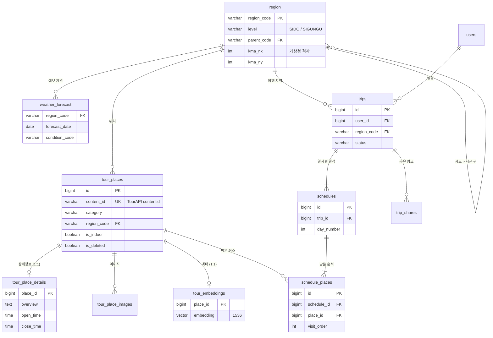

# 🗄 TP 통합 DB 스키마 (초안)

> AI.md · BATCH.md · BACKEND.md에 흩어져 있던 테이블 정의를 하나로 합친 문서입니다.
> **상태: 초안 — 맨 아래 [팀 합의가 필요한 것](#팀-합의가-필요한-것)을 정한 뒤 확정합니다.**
> 확정되면 각 md의 테이블 정의는 이 문서를 참조하도록 바꿉니다.

- DB: PostgreSQL 16 + pgvector, DB 이름 `tour_db` (ROOT.md `.env` 기준)
- 임베딩: OpenAI `text-embedding-3-small`, **1536차원** (AI.md · BATCH.md 기준)

---

## 목차
1. [전체 구조 (ERD)](#1-전체-구조-erd)
2. [테이블별 소유 서비스](#2-테이블별-소유-서비스)
3. [공통 코드 (Enum)](#3-공통-코드-enum)
4. [DDL](#4-ddl)
5. [주요 조회 쿼리](#5-주요-조회-쿼리)
6. [DB 계정과 권한](#6-db-계정과-권한)
7. [기존 md와 달라진 점](#7-기존-md와-달라진-점)
8. [팀 합의가 필요한 것](#팀-합의가-필요한-것)

---

## 1. 전체 구조 (ERD)



운영용 테이블 `batch_job_log`, `api_call_quota`는 다른 테이블과 관계가 없어 ERD에서 뺐습니다.

---

## 2. 테이블별 소유 서비스

같은 DB를 여러 서비스가 함께 쓰므로, **쓰는 쪽은 한 서비스로** 정합니다.

| 테이블 | 쓰는 쪽 | 읽는 쪽 | 출처 |
| :--- | :--- | :--- | :--- |
| `region` | 배치 (초기 적재) | 전부 | **신규** |
| `tour_places` | 배치 | AI, 백엔드 | BATCH.md 7.1 + BACKEND.md ERD |
| `tour_place_details` | 배치 | AI | BATCH.md BT-002 |
| `tour_place_images` | 배치 | 백엔드 | BATCH.md BT-008 |
| `tour_embeddings` | 배치 | AI | BATCH.md 7.2 |
| `weather_forecast` | 배치 | 백엔드 | BATCH.md 7.3 |
| `users`, `trips`, `schedules`, `schedule_places`, `trip_shares` | 백엔드 | 백엔드 | BACKEND.md 6.1 |
| `batch_job_log` | 배치 | 배치 | BATCH.md BT-014 |
| `api_call_quota` | 배치 | 배치 | **신규** (호출 한도 관리) |

- AI 서비스는 DB를 **읽기만** 합니다. 날씨는 DB에서 직접 읽지 않고 백엔드가 요청에 담아 보냅니다 (ROOT.md 흐름 2~4).
- 배치는 `tour_places`를 **물리 삭제하지 않습니다.** `schedule_places`가 참조하므로 폐업·삭제 장소는 `is_deleted = TRUE`로만 표시합니다 (BT-009).

---

## 3. 공통 코드 (Enum)

DB에는 `VARCHAR` + `CHECK`로 저장합니다. 백엔드(Kotlin), AI·배치(Python), 프론트(TypeScript)는 아래 값을 그대로 씁니다.

| 코드 | 값 | 비고 |
| :--- | :--- | :--- |
| **Category** (장소 분류) | `TOUR_SPOT`, `CULTURE`, `FESTIVAL`, `LEISURE`, `ACCOMMODATION`, `SHOPPING`, `RESTAURANT`, `CAFE` | BATCH.md 10.3 `CategoryType` + `CAFE` |
| **WeatherCondition** | `SUNNY`, `CLOUDY`, `RAIN`, `SNOW` | BATCH.md 10.3, 5.2 |
| **Season** | `SPRING`, `SUMMER`, `AUTUMN`, `WINTER` | 장소의 추천 계절 |
| **Theme** (여행 취향) | `NATURE`, `HISTORY_CULTURE`, `FOOD`, `CAFE`, `ACTIVITY`, `SHOPPING`, `FESTIVAL`, `HEALING` | 일정 생성 요청 초안. 0~3개, 빈 배열은 '골고루' |
| **Transport** (이동수단) | `CAR`, `PUBLIC_TRANSIT`, `WALK` | 일정 생성 요청 초안 |
| **CompanionType** (동행) | `SOLO`, `COUPLE`, `FRIENDS`, `FAMILY_WITH_KIDS`, `FAMILY_WITH_PARENTS`, `GROUP` | 일정 생성 요청 초안 |
| **PlacesPerDay** (하루 방문 수) | `RELAXED`, `NORMAL`, `PACKED` | 일정 생성 요청 초안 |
| **StartTime** (첫 일정 시작) | `EARLY`(08:00), `NORMAL`(10:00), `LATE`(11:00) | 일정 생성 요청 초안. 종료는 모두 21:00 |
| **TripStatus** | `GENERATING`, `COMPLETED`, `FAILED` | AI 일정 생성 진행 상태 |
| **RegionLevel** | `SIDO`, `SIGUNGU` | |

**일정 생성 요청 초안**: FE `feat/fe-main-page` 브랜치의 `tripRequestOptions.js`와 AI `feat/ai-schedule-pipeline` 브랜치의 `02_요청 데이터 명세 초안.md`. 두 곳 모두 코드값이 임시라, 팀 회의에서 확정되면 이 표와 함께 고칩니다.

**Category와 TourAPI 관광타입(contentTypeId) 대응**

| contentTypeId | Category |
| :--- | :--- |
| 12 관광지 | `TOUR_SPOT` |
| 14 문화시설 | `CULTURE` |
| 15 축제/공연/행사 | `FESTIVAL` |
| 28 레포츠 | `LEISURE` |
| 32 숙박 | `ACCOMMODATION` |
| 38 쇼핑 | `SHOPPING` |
| 39 음식점 | `RESTAURANT`, 카페 분류(구분류 `A05020900`)는 `CAFE` |

`CAFE`를 따로 두는 이유: AI.md의 출력 예시와 "카페 2곳 연속 배치 금지" 규칙, 프론트의 '카페/미식' 테마가 카페를 음식점과 구분해서 다룹니다.

---

## 4. DDL

> 마이그레이션 위치와 실행 주체는 [팀 합의가 필요한 것](#팀-합의가-필요한-것) 5번 참고.
> 시각 컬럼은 모두 `TIMESTAMPTZ`(한국 시간 혼동 방지)로 통일했습니다.

```sql
CREATE EXTENSION IF NOT EXISTS vector;
```

### 4.1 `region` — 지역 마스터 (신규)

요청(`regionCode: "PUSAN"`), 장소, 날씨를 하나의 지역 코드로 묶기 위한 테이블입니다.
TourAPI 지역코드와 기상청 격자·예보구역을 여기서 매핑합니다.

```sql
CREATE TABLE region (
    region_code       VARCHAR(20)  PRIMARY KEY,             -- 예: PUSAN, GANGWON, GANGNEUNG
    name              VARCHAR(50)  NOT NULL,                -- 예: 부산광역시, 강릉시
    level             VARCHAR(10)  NOT NULL CHECK (level IN ('SIDO', 'SIGUNGU')),
    parent_code       VARCHAR(20)  REFERENCES region (region_code),  -- 시군구 → 상위 시도
    tour_area_code    VARCHAR(10),                          -- TourAPI areaCode
    tour_sigungu_code VARCHAR(10),                          -- TourAPI sigunguCode
    ldong_regn_cd     VARCHAR(10),                          -- TourAPI 법정동 시도 코드 (KorService2)
    ldong_signgu_cd   VARCHAR(10),                          -- TourAPI 법정동 시군구 코드 (KorService2)
    kma_nx            INTEGER,                              -- 기상청 단기예보 격자 X (대표 지점)
    kma_ny            INTEGER,                              -- 기상청 단기예보 격자 Y
    kma_mid_reg_id    VARCHAR(10),                          -- 기상청 중기예보 구역코드
    latitude          DOUBLE PRECISION,                     -- 대표 좌표 (격자 변환, 지도 중심)
    longitude         DOUBLE PRECISION
);
```

- 프론트의 지역 선택지(부산, 제주, 강릉 …)는 이 테이블의 행입니다. 시도(부산)와 시군구(강릉)를 모두 고를 수 있습니다.
- 시도를 고르면 장소 검색은 하위 시군구까지 포함합니다 ([5.1](#51-ai-1단계-장소-추출) 참고).
- 격자(nx, ny)는 대표 좌표를 BATCH.md 10.2의 `convert_to_grid()`로 변환해 채웁니다.

### 4.2 `tour_places` — 장소 (BT-001, 003~007, 009, 011)

축제·숙박도 이 테이블에 함께 넣습니다 (BATCH.md의 `tour_festivals`, `tour_accommodations`를 통합). `schedule_places.place_id`가 한 테이블만 참조해야 일정에 축제·숙소를 넣을 수 있기 때문입니다.

```sql
CREATE TABLE tour_places (
    id                 BIGSERIAL    PRIMARY KEY,
    content_id         VARCHAR(50)  NOT NULL UNIQUE,        -- TourAPI contentid
    content_type_id    VARCHAR(10)  NOT NULL,               -- 12, 14, 15, 28, 32, 38, 39
    name               VARCHAR(255) NOT NULL,
    category           VARCHAR(20)  NOT NULL CHECK (category IN (
                           'TOUR_SPOT', 'CULTURE', 'FESTIVAL', 'LEISURE',
                           'ACCOMMODATION', 'SHOPPING', 'RESTAURANT', 'CAFE')),
    region_code        VARCHAR(20)  NOT NULL REFERENCES region (region_code),  -- 시군구 단위
    address            VARCHAR(255),
    latitude           DOUBLE PRECISION NOT NULL,           -- TourAPI mapy
    longitude          DOUBLE PRECISION NOT NULL,           -- TourAPI mapx
    image_url          VARCHAR(1000),                       -- 대표 이미지 (firstimage)
    is_indoor          BOOLEAN      NOT NULL DEFAULT FALSE, -- BT-011 실내 여부
    suitable_weathers  VARCHAR(10)[] NOT NULL DEFAULT '{}', -- BT-011, WeatherCondition 값
    suitable_seasons   VARCHAR(10)[] NOT NULL DEFAULT '{}', -- BT-011, Season 값 (비어 있으면 사계절)
    source_modified_at TIMESTAMPTZ,                         -- TourAPI modifiedtime (증분 동기화 기준)
    is_deleted         BOOLEAN      NOT NULL DEFAULT FALSE, -- BT-009
    created_at         TIMESTAMPTZ  NOT NULL DEFAULT now(),
    updated_at         TIMESTAMPTZ  NOT NULL DEFAULT now()
);

CREATE INDEX ix_tour_places_region   ON tour_places (region_code) WHERE is_deleted = FALSE;
CREATE INDEX ix_tour_places_category ON tour_places (category);
```

### 4.3 `tour_place_details` — 상세정보 (BT-002)

목록 API(BT-001)와 상세 API(BT-002)는 호출 비용과 갱신 주기가 달라서 테이블을 나눕니다. 상세 API는 장소당 1회 호출이라 일일 호출 한도 안에서 조금씩 채워집니다.

```sql
CREATE TABLE tour_place_details (
    place_id           BIGINT       PRIMARY KEY REFERENCES tour_places (id) ON DELETE CASCADE,
    overview           TEXT,                                -- 개요 (임베딩 텍스트의 본문)
    business_hours     TEXT,                                -- 운영시간 원문
    holiday_info       TEXT,                                -- 휴무일 원문
    open_time          TIME,                                -- 대표 개장 시각 (해석 못 하면 NULL)
    close_time         TIME,                                -- 대표 폐장 시각 (open_time보다 작으면 다음 날)
    closed_weekdays    VARCHAR(3)[] NOT NULL DEFAULT '{}',  -- 매주 쉬는 요일: MON ~ SUN
    closed_on_holidays BOOLEAN      NOT NULL DEFAULT FALSE, -- 공휴일 휴무
    parking_info       TEXT,                                -- 주차 원문
    main_menu          VARCHAR(255),                        -- 음식점 대표메뉴 (BT-003)
    event_start_date   DATE,                                -- 축제 시작일 (BT-005)
    event_end_date     DATE,                                -- 축제 종료일
    fetched_at         TIMESTAMPTZ  NOT NULL DEFAULT now(), -- 상세 API를 조회한 시각
    updated_at         TIMESTAMPTZ  NOT NULL DEFAULT now()
);
```

- **원문과 정리한 값을 함께 저장합니다.** `open_time`, `closed_weekdays`는 AI의 `filterBusinessHours()` / `filterHoliday()` 필터용이고, 원문(`business_hours`, `holiday_info`)은 LLM 프롬프트에 그대로 넣습니다.
- **해석하지 못한 값은 NULL로 둡니다.** 필터는 NULL을 '제외'가 아니라 '통과'로 처리합니다. 잘못 채우면 멀쩡히 여는 장소가 추천에서 빠지기 때문입니다.
- `fetched_at`이 `tour_places.source_modified_at`보다 오래되면 다시 조회합니다.

### 4.4 `tour_place_images` — 이미지 (BT-008)

```sql
CREATE TABLE tour_place_images (
    id            BIGSERIAL     PRIMARY KEY,
    place_id      BIGINT        NOT NULL REFERENCES tour_places (id) ON DELETE CASCADE,
    image_url     VARCHAR(1000) NOT NULL,
    thumbnail_url VARCHAR(1000),
    is_valid      BOOLEAN       NOT NULL DEFAULT TRUE,      -- BT-008 URL 유효성 검증 결과
    updated_at    TIMESTAMPTZ   NOT NULL DEFAULT now(),
    UNIQUE (place_id, image_url)
);
```

### 4.5 `tour_embeddings` — RAG 벡터 (BT-012)

```sql
CREATE TABLE tour_embeddings (
    place_id    BIGINT       PRIMARY KEY REFERENCES tour_places (id) ON DELETE CASCADE,
    chunk_text  TEXT         NOT NULL,                      -- 임베딩에 쓴 텍스트 (BATCH.md 4.1 템플릿)
    embedding   vector(1536) NOT NULL,
    model_name  VARCHAR(100) NOT NULL DEFAULT 'text-embedding-3-small',
    updated_at  TIMESTAMPTZ  NOT NULL DEFAULT now()
);

CREATE INDEX idx_tour_embeddings_hnsw
    ON tour_embeddings USING hnsw (embedding vector_cosine_ops);
```

- `tour_places.updated_at` 또는 `tour_place_details.updated_at`이 `tour_embeddings.updated_at`보다 새로우면 다시 임베딩합니다 (BATCH.md 6.3 증분 업데이트).
- `model_name`을 남겨 두면 모델을 바꿀 때 다시 계산할 대상을 찾을 수 있습니다.

### 4.6 `weather_forecast` — 날씨 예보 (BT-010)

```sql
CREATE TABLE weather_forecast (
    id                 BIGSERIAL   PRIMARY KEY,
    region_code        VARCHAR(20) NOT NULL REFERENCES region (region_code),
    forecast_date      DATE        NOT NULL,
    condition_code     VARCHAR(10) NOT NULL CHECK (condition_code IN ('SUNNY', 'CLOUDY', 'RAIN', 'SNOW')),
    temperature        DOUBLE PRECISION,                    -- 대표 기온 (℃)
    precipitation_prob INTEGER,                             -- 강수확률 (%)
    source             VARCHAR(10) NOT NULL CHECK (source IN ('SHORT', 'MID')),  -- 단기 / 중기예보
    updated_at         TIMESTAMPTZ NOT NULL DEFAULT now(),
    CONSTRAINT uk_region_date UNIQUE (region_code, forecast_date)
);
```

- 기상청 예보는 길어야 10일 정도 앞까지만 나옵니다. 가까운 날짜는 단기예보(`SHORT`), 그 뒤는 중기예보(`MID`)로 채웁니다.
- **해당 날짜에 행이 없으면** 백엔드는 날씨 없이 계절 정보만 AI에 보냅니다.
- 3시간 단위 예보를 하루 한 행으로 합치는 규칙은 [팀 합의가 필요한 것](#팀-합의가-필요한-것) 6번 참고.

### 4.7 `users` — 회원

```sql
CREATE TABLE users (
    id          BIGSERIAL    PRIMARY KEY,
    email       VARCHAR(255) NOT NULL UNIQUE,
    nickname    VARCHAR(50)  NOT NULL,
    created_at  TIMESTAMPTZ  NOT NULL DEFAULT now(),
    updated_at  TIMESTAMPTZ  NOT NULL DEFAULT now(),
    deleted_at  TIMESTAMPTZ
);
```

BACKEND.md ERD에 USERS가 있지만 컬럼과 인증 API는 정의되어 있지 않습니다. 인증 방식(자체 가입 / 카카오 로그인 등)이 정해지면 컬럼을 추가합니다.

### 4.8 `trips` — 여행 (BACKEND.md TRIP)

```sql
CREATE TABLE trips (
    id               BIGSERIAL     PRIMARY KEY,
    user_id          BIGINT        REFERENCES users (id),   -- 로그인 범위가 정해지면 NOT NULL 여부 결정
    title            VARCHAR(100),                          -- AI tripName (생성 완료 후 채움)
    region_code      VARCHAR(20)   NOT NULL REFERENCES region (region_code),
    start_date       DATE          NOT NULL,
    end_date         DATE          NOT NULL,
    companion_type   VARCHAR(30)   NOT NULL CHECK (companion_type IN (
                         'SOLO', 'COUPLE', 'FRIENDS', 'FAMILY_WITH_KIDS', 'FAMILY_WITH_PARENTS', 'GROUP')),
    traveler_count   SMALLINT      NOT NULL DEFAULT 1 CHECK (traveler_count BETWEEN 1 AND 100),
    transport        VARCHAR(20)   NOT NULL CHECK (transport IN ('CAR', 'PUBLIC_TRANSIT', 'WALK')),
    themes           VARCHAR(20)[] NOT NULL DEFAULT '{}'    -- 0~3개, 비어 있으면 '골고루'
                         CHECK (cardinality(themes) <= 3
                            AND themes <@ ARRAY['NATURE', 'HISTORY_CULTURE', 'FOOD', 'CAFE',
                                                'ACTIVITY', 'SHOPPING', 'FESTIVAL', 'HEALING']::VARCHAR(20)[]),
    places_per_day   VARCHAR(10)   NOT NULL DEFAULT 'NORMAL' CHECK (places_per_day IN ('RELAXED', 'NORMAL', 'PACKED')),
    start_time       VARCHAR(10)   NOT NULL DEFAULT 'NORMAL' CHECK (start_time IN ('EARLY', 'NORMAL', 'LATE')),
    weather_summary  TEXT,                                  -- AI weatherSummary
    memo             TEXT,                                  -- TR-003 메모
    status           VARCHAR(20)   NOT NULL DEFAULT 'GENERATING'
                         CHECK (status IN ('GENERATING', 'COMPLETED', 'FAILED')),
    created_at       TIMESTAMPTZ   NOT NULL DEFAULT now(),
    updated_at       TIMESTAMPTZ   NOT NULL DEFAULT now(),
    deleted_at       TIMESTAMPTZ,                           -- TR-004 Soft Delete
    CONSTRAINT ck_trip_period CHECK (end_date >= start_date AND end_date - start_date <= 13)  -- 최대 14일 (AI 상한)
);

CREATE INDEX ix_trips_user ON trips (user_id) WHERE deleted_at IS NULL;
```

- 요청 필드 이름과 코드값은 [일정 생성 요청 초안](#3-공통-코드-enum)을 따릅니다 (`companion_type`, `traveler_count`, `transport`, `themes`, `places_per_day`, `start_time`).
- 요청의 `regionCodes`는 TourAPI 지역코드(예: 부산 `"6"`)로 옵니다. 백엔드는 `region_code`가 같은 행, 없으면 `tour_area_code`가 같은 시도 행을 찾아 그 `region_code`를 저장합니다. 지역은 지금 1개만 받습니다 (여러 지역을 받으려면 여행-지역 테이블을 따로 둬야 함).
- `status`는 AI 일정 생성이 오래 걸릴 때를 대비한 값입니다. 생성 요청 시 `GENERATING`으로 저장하고, AI 응답을 받으면 `COMPLETED`/`FAILED`로 바꿉니다.
- 최대 14일 제한은 AI 서비스의 상한(TP_AI `API_SPEC.md` 3.2) 기준입니다. FE는 개발 단계라 상한을 두지 않았습니다.

### 4.9 `schedules` — 일자별 일정 (BACKEND.md SCHEDULE)

```sql
CREATE TABLE schedules (
    id                 BIGSERIAL   PRIMARY KEY,
    trip_id            BIGINT      NOT NULL REFERENCES trips (id) ON DELETE CASCADE,
    day_number         SMALLINT    NOT NULL,                -- 1일차, 2일차 …
    schedule_date      DATE        NOT NULL,
    weather_condition  VARCHAR(10) CHECK (weather_condition IN ('SUNNY', 'CLOUDY', 'RAIN', 'SNOW')),
    temperature        DOUBLE PRECISION,                    -- 일자 탭 표시용 (예: "비 16℃")
    precipitation_prob INTEGER,
    UNIQUE (trip_id, day_number)
);
```

날씨는 **일정을 생성한 시점의 값을 복사해 둡니다.** 예보는 계속 바뀌므로, AI가 어떤 날씨를 보고 일정을 짰는지 남기기 위해서입니다.

### 4.10 `schedule_places` — 방문 장소 (BACKEND.md SCHEDULE_PLACE)

```sql
CREATE TABLE schedule_places (
    id           BIGSERIAL PRIMARY KEY,
    schedule_id  BIGINT    NOT NULL REFERENCES schedules (id) ON DELETE CASCADE,
    place_id     BIGINT    NOT NULL REFERENCES tour_places (id),
    visit_order  SMALLINT  NOT NULL,                        -- AI step
    start_time   TIME,
    end_time     TIME,
    reason       TEXT,                                      -- AI 추천 사유 · 날씨 팁 (화면 말풍선)
    UNIQUE (schedule_id, visit_order)
);
```

체류 시간(`stayTimeMinutes`)은 `end_time - start_time`으로 계산되므로 따로 저장하지 않습니다.

### 4.11 `trip_shares` — 공유 링크 (PLAN-002)

```sql
CREATE TABLE trip_shares (
    id          BIGSERIAL   PRIMARY KEY,
    trip_id     BIGINT      NOT NULL REFERENCES trips (id) ON DELETE CASCADE,
    token       VARCHAR(64) NOT NULL UNIQUE,                -- 공유 URL: https://trp.com/s/{token}
    expires_at  TIMESTAMPTZ,                                -- NULL이면 만료 없음
    created_at  TIMESTAMPTZ NOT NULL DEFAULT now()
);
```

### 4.12 `batch_job_log` — 배치 실행 이력 (BT-014)

```sql
CREATE TABLE batch_job_log (
    id              BIGSERIAL   PRIMARY KEY,
    job_id          VARCHAR(10) NOT NULL,                   -- BT-001 ~ BT-013
    started_at      TIMESTAMPTZ NOT NULL DEFAULT now(),
    finished_at     TIMESTAMPTZ,
    status          VARCHAR(10) NOT NULL CHECK (status IN ('RUNNING', 'SUCCESS', 'PARTIAL', 'FAILED')),
    processed_count INTEGER     NOT NULL DEFAULT 0,
    failed_count    INTEGER     NOT NULL DEFAULT 0,
    error_message   TEXT
);
```

### 4.13 `api_call_quota` — 외부 API 일일 호출 수 (신규)

TourAPI 개발계정은 서비스마다 하루 호출 수가 정해져 있어, 한도를 넘기기 전에 멈추려면 호출 수를 세야 합니다.

```sql
CREATE TABLE api_call_quota (
    usage_date  DATE        NOT NULL,                       -- 한국 시간 기준 (한도가 KST 자정에 초기화)
    service     VARCHAR(50) NOT NULL,                       -- 예: KorService2, VilageFcstInfoService_2.0
    calls       INTEGER     NOT NULL DEFAULT 0,
    PRIMARY KEY (usage_date, service)
);
```

---

## 5. 주요 조회 쿼리

### 5.1 AI 1단계: 장소 추출

AI.md 3.2의 쿼리를 이 스키마에 맞춘 버전입니다. 임베딩은 `tour_embeddings`에 있으므로 JOIN합니다.

```sql
SELECT
    p.id, p.name, p.category, p.latitude, p.longitude, p.is_indoor,
    d.business_hours, d.holiday_info, d.open_time, d.close_time, d.closed_weekdays,
    1 - (e.embedding <=> :query_vector) AS similarity
FROM tour_places p
JOIN tour_embeddings e         ON e.place_id = p.id
LEFT JOIN tour_place_details d ON d.place_id = p.id
WHERE p.is_deleted = FALSE
  AND p.region_code IN (                                     -- 시도를 고르면 하위 시군구 포함
        SELECT region_code FROM region
        WHERE region_code = :regionCode OR parent_code = :regionCode)
  AND (:isRain = FALSE OR p.is_indoor = TRUE)
ORDER BY e.embedding <=> :query_vector                       -- 거리로 정렬해야 HNSW 인덱스를 탄다
LIMIT 25;
```

- WHERE 조건과 HNSW 인덱스를 함께 쓰면 pgvector가 인덱스 결과를 먼저 뽑고 나중에 걸러서, `LIMIT`보다 적은 행이 나올 수 있습니다. pgvector 0.8 이상이면 `SET hnsw.iterative_scan = relaxed_order;`로 보완합니다.
- 점심·저녁 음식점 배치 규칙(AI.md 6.1)을 지키려면 `category IN ('RESTAURANT', 'CAFE')` 조건으로 한 번 더 조회해 후보에 섞는 것을 권장합니다.

### 5.2 AI 2단계: 운영시간·휴무일 필터

```sql
-- :visitDay = 'THU', :visitTime = '14:00'
AND NOT (:visitDay = ANY (COALESCE(d.closed_weekdays, '{}')))  -- 상세정보가 없으면(NULL) 통과
AND (
      d.open_time IS NULL                                    -- 모르면 통과
   OR (d.open_time <= d.close_time AND :visitTime BETWEEN d.open_time AND d.close_time)
   OR (d.open_time >  d.close_time AND (:visitTime >= d.open_time OR :visitTime <= d.close_time))  -- 자정 넘김
)
```

### 5.3 백엔드: 여행 기간 날씨 조회

```sql
SELECT forecast_date, condition_code, temperature, precipitation_prob
FROM weather_forecast
WHERE region_code = :regionCode
  AND forecast_date BETWEEN :startDate AND :endDate
ORDER BY forecast_date;
-- 행이 없는 날짜는 계절 정보만 AI에 전달
```

---

## 6. DB 계정과 권한

서비스마다 DB 계정을 따로 두고, **각 계정에는 그 서비스가 실제로 쓰는 테이블 권한만** 줍니다 ([2. 테이블별 소유 서비스](#2-테이블별-소유-서비스) 기준).
한 서비스의 접속 정보가 새어도 다른 서비스의 데이터(특히 회원·여행 정보)는 지킬 수 있습니다.

### 6.1 계정

| 계정 | 쓰는 곳 | 역할 |
| :--- | :--- | :--- |
| `tp_owner` | 마이그레이션(Flyway) 전용 | 모든 테이블의 소유자. 애플리케이션은 이 계정으로 접속하지 않음 |
| `tp_batch` | TP_BATCH | 장소·날씨·운영 테이블 쓰기 |
| `tp_ai` | TP_AI | 장소·임베딩 **읽기 전용** |
| `tp_backend` | TP_BE | 회원·여행·일정 쓰기, 장소·날씨 읽기 |

- 테이블은 `tp_owner`가 만들므로 서비스 계정은 테이블을 `DROP`·`ALTER`·`TRUNCATE`할 수 없습니다.
- 각 서비스의 `.env`에는 자기 계정만 넣습니다. ROOT.md 예시처럼 모든 서비스가 관리자 계정(`tour_admin`) 하나를 같이 쓰지 않습니다.

### 6.2 테이블별 권한

| 테이블 | `tp_batch` | `tp_ai` | `tp_backend` |
| :--- | :--- | :--- | :--- |
| `region` | SELECT, INSERT, UPDATE | SELECT | SELECT |
| `tour_places` | SELECT, INSERT, UPDATE | SELECT | SELECT |
| `tour_place_details` | SELECT, INSERT, UPDATE | SELECT | SELECT |
| `tour_place_images` | SELECT, INSERT, UPDATE, DELETE | - | SELECT |
| `tour_embeddings` | SELECT, INSERT, UPDATE | SELECT | - |
| `weather_forecast` | SELECT, INSERT, UPDATE, DELETE | - | SELECT |
| `users` | - | - | SELECT, INSERT, UPDATE |
| `trips` | - | - | SELECT, INSERT, UPDATE |
| `schedules` | - | - | SELECT, INSERT, UPDATE, DELETE |
| `schedule_places` | SELECT | - | SELECT, INSERT, UPDATE, DELETE |
| `trip_shares` | - | - | SELECT, INSERT, DELETE |
| `batch_job_log` | SELECT, INSERT, UPDATE | - | - |
| `api_call_quota` | SELECT, INSERT, UPDATE | - | - |

권한을 이렇게 나눈 이유:

- **`tour_places`, `trips`, `users`에는 누구에게도 DELETE를 주지 않습니다.** 장소는 `is_deleted`, 여행·회원은 `deleted_at`으로만 지우는 규칙(BT-009, TR-004)을 DB가 강제합니다.
- **`tp_ai`는 읽기 전용**이고, 접속 자체도 읽기 전용 트랜잭션으로 고정합니다. 날씨는 백엔드가 요청에 담아 보내므로 `weather_forecast` 권한도 없습니다.
- **`tp_batch`는 회원·여행 테이블을 볼 수 없습니다.** 예외로 BT-013(인기 장소 집계)용으로 `schedule_places`만 읽을 수 있습니다. 이 테이블에는 장소 ID와 방문 시각만 있고 개인정보는 없습니다.
- `tour_place_images`(깨진 이미지 정리)와 `weather_forecast`(지난 예보 정리)만 배치가 DELETE할 수 있습니다.
- `tp_backend`는 일정 수동 편집(PLAN-001)을 위해 `schedules`, `schedule_places`를 지우고 다시 쓸 수 있고, 공유 링크를 취소하기 위해 `trip_shares`를 지울 수 있습니다.

### 6.3 계정 만들기 (DB 관리자가 한 번 실행)

계정 생성은 비밀번호가 들어가므로 **저장소의 마이그레이션에 넣지 않습니다.** 관리자 계정으로 아래 스크립트를 실행하고, 비밀번호는 실행할 때만 넘깁니다.

```bash
psql -h <DB_HOST> -U postgres -d tour_db \
  -v owner_password=... -v batch_password=... -v ai_password=... -v backend_password=... \
  -f create_roles.sql
```

```sql
-- create_roles.sql
CREATE EXTENSION IF NOT EXISTS vector;

CREATE ROLE tp_owner   LOGIN PASSWORD :'owner_password';
CREATE ROLE tp_batch   LOGIN PASSWORD :'batch_password';
CREATE ROLE tp_ai      LOGIN PASSWORD :'ai_password';
CREATE ROLE tp_backend LOGIN PASSWORD :'backend_password';

-- AI 계정은 접속하면 항상 읽기 전용 트랜잭션
ALTER ROLE tp_ai SET default_transaction_read_only = on;

-- 기본으로 열려 있는 접속·스키마 권한을 닫고 필요한 계정에만 연다
REVOKE ALL ON DATABASE tour_db FROM PUBLIC;
GRANT CONNECT ON DATABASE tour_db TO tp_owner, tp_batch, tp_ai, tp_backend;

REVOKE ALL ON SCHEMA public FROM PUBLIC;
GRANT USAGE, CREATE ON SCHEMA public TO tp_owner;
GRANT USAGE         ON SCHEMA public TO tp_batch, tp_ai, tp_backend;
```

### 6.4 테이블 권한 부여 (마이그레이션에 포함, `tp_owner`로 실행)

```sql
-- 배치
GRANT SELECT, INSERT, UPDATE
    ON region, tour_places, tour_place_details, tour_embeddings, batch_job_log, api_call_quota
    TO tp_batch;
GRANT SELECT, INSERT, UPDATE, DELETE ON tour_place_images, weather_forecast TO tp_batch;
GRANT SELECT ON schedule_places TO tp_batch;                    -- BT-013 인기 장소 집계
GRANT USAGE, SELECT ON SEQUENCE
    tour_places_id_seq, tour_place_images_id_seq, weather_forecast_id_seq, batch_job_log_id_seq
    TO tp_batch;

-- AI (읽기 전용)
GRANT SELECT ON region, tour_places, tour_place_details, tour_embeddings TO tp_ai;

-- 백엔드
GRANT SELECT ON region, tour_places, tour_place_details, tour_place_images, weather_forecast TO tp_backend;
GRANT SELECT, INSERT, UPDATE         ON users, trips              TO tp_backend;
GRANT SELECT, INSERT, UPDATE, DELETE ON schedules, schedule_places TO tp_backend;
GRANT SELECT, INSERT, DELETE         ON trip_shares               TO tp_backend;
GRANT USAGE, SELECT ON SEQUENCE
    users_id_seq, trips_id_seq, schedules_id_seq, schedule_places_id_seq, trip_shares_id_seq
    TO tp_backend;
```

- `BIGSERIAL` 컬럼에 INSERT하려면 테이블 권한과 별도로 **시퀀스 권한**(`USAGE`)이 필요합니다.
- **새 테이블을 추가할 때는 같은 마이그레이션 파일에 GRANT도 함께 넣습니다.** 기본 권한(`ALTER DEFAULT PRIVILEGES`)을 일부러 쓰지 않아서, GRANT를 빠뜨리면 아무 서비스도 접근하지 못합니다. 실수해도 권한이 넓어지는 쪽이 아니라 막히는 쪽으로 나게 하기 위해서입니다.

권한이 의도대로 들어갔는지는 아래 쿼리로 확인합니다.

```sql
SELECT grantee, table_name, string_agg(privilege_type, ', ' ORDER BY privilege_type) AS privileges
FROM information_schema.role_table_grants
WHERE grantee IN ('tp_batch', 'tp_ai', 'tp_backend')
GROUP BY grantee, table_name
ORDER BY grantee, table_name;
```

---

## 7. 기존 md와 달라진 점

이 스키마를 확정하면 각 md에서 아래 부분을 고칩니다.

| 문서 | 위치 | 바꿀 내용 |
| :--- | :--- | :--- |
| AI.md | 3.2 검색 쿼리 | `tour_places.embedding` → `tour_embeddings` JOIN ([5.1](#51-ai-1단계-장소-추출)) |
| AI.md | 5.1 출력 예시 | `category: INDOOR_EXHIBITION` → `CULTURE` (실내 여부는 `is_indoor`) |
| BATCH.md | 3 잡 명세 | BT-004 `tour_accommodations`, BT-005 `tour_festivals` → `tour_places`로 통합 |
| BATCH.md | 3 잡 명세 | BT-002 → `tour_place_details`, BT-008 → `tour_place_images`, BT-011 → `tour_places`의 `is_indoor`·`suitable_*` 컬럼 |
| BATCH.md | 4.1 청크 템플릿 | `region_name`, `sigungu_name` → `region.name`, `holiday_info` 등은 `tour_place_details`에서 읽음 |
| BATCH.md | 7 DDL | 이 문서로 링크 |
| BATCH.md | 10.3 CategoryType | `CAFE` 추가 |
| BACKEND.md | 6.1 ERD | 이 문서로 링크. TRIP에 `user_id`·`companion_type`·`traveler_count`·`transport`·`themes`·`places_per_day`·`start_time`·`deleted_at`, SCHEDULE에 기온 추가 |
| FRONTEND.md | 3.1 여행 생성 | fe 브랜치에서 재작성됨. 코드값은 [3. 공통 코드](#3-공통-코드-enum)의 일정 생성 요청 초안과 같음 |
| ROOT.md | 로컬 개발 환경 `.env` | `DB_USER=tour_admin` 하나 → 서비스별 계정 ([6. DB 계정과 권한](#6-db-계정과-권한)) |
| BACKEND.md | 10 `application.yml` | `DB_USER` 기본값 `tour_admin` → `tp_backend`. Flyway는 `tp_owner`로 접속 |
| AI.md | 12 `.env` | `DATABASE_URL`의 계정 `tour_admin` → `tp_ai` |
| BATCH.md | 10.3 `.env` | `DATABASE_URL`의 계정 `tour_admin` → `tp_batch` |

---

## 팀 합의가 필요한 것

| # | 결정할 것 | 이 초안의 제안 |
| :--- | :--- | :--- |
| 1 | 지역 코드 값과 단위 | 시도 + 시군구 2단계, 코드는 영문 대문자 (`PUSAN`, `GANGNEUNG`) |
| 2 | 축제·숙박 테이블 | `tour_places`로 통합 (일정에서 한 테이블만 참조하도록) |
| 3 | 로그인 범위 | 미정 — 정해지면 `users` 컬럼과 `trips.user_id` NOT NULL 여부 확정 |
| 4 | 공유 단위 | BACKEND.md PLAN-002는 `scheduleId`를 받지만, 여행 전체(`trip`) 단위 공유를 제안 |
| 5 | 마이그레이션 위치·주체 | 모노레포 루트 `db/migration/`에 SQL을 모으고 백엔드 Flyway가 `tp_owner` 계정으로 실행. 배치·AI는 테이블을 만들지 않음 (백엔드는 이미 `ddl-auto: validate`) |
| 6 | 날씨 하루 집계 규칙 | 09~21시 중 가장 나쁜 날씨(`SNOW` > `RAIN` > `CLOUDY` > `SUNNY`), 기온은 낮 최고기온, 강수확률은 최댓값 |
| 7 | 실내외 겸용 장소 | 시장·동굴처럼 비를 어느 정도 피할 수 있는 곳을 `is_indoor`에서 어떻게 볼지 |
| 8 | DB 계정 관리 | 관리자 계정과 서비스 계정 비밀번호를 누가 만들고 어떻게 공유할지. 팀원이 데이터를 조회할 개발용 읽기 전용 계정(`users`·`trips` 제외)이 필요한지 |
