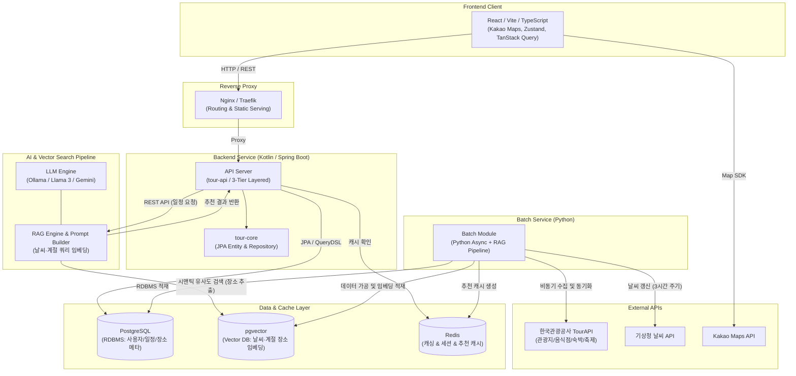
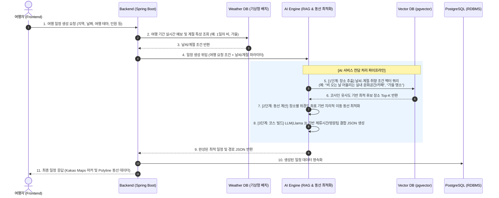

# ✈️ Trp (Travel Route Planner)
> **AI 및 공공데이터(TourAPI·기상청) 기반 맞춤형 여행 일정 및 최적 동선 추천 플랫폼**

```markdown
# 🔗 프로젝트 메인 Git 저장소 (Repository URL)
GIT_MAIN_REPO="https://github.com/Class4072/Mini_Project_1"
```

---

## 📌 목차
1. [프로젝트 개요](#-프로젝트-개요)
2. [시스템 아키텍처](#-시스템-아키텍처)
3. [하위 파트별 상세 문서 및 Git 저장소](#-하위-파트별-상세-문서-및-git-저장소)
4. [기술 스택 종합](#-기술-스택-종합)
5. [핵심 기능 및 서비스 흐름](#-핵심-기능-및-서비스-흐름)
6. [로컬 개발 환경 구축 (Docker)](#-로컬-개발-환경-구축-docker)
7. [Git 브랜치 전략 및 협업 규칙](#-git-브랜치-전략-및-협업-규칙)

---

## 📖 프로젝트 개요

**Trp**는 여행자의 취향, 일정, 예산과 함께 **한국관광공사 TourAPI의 공공데이터**, **실시간 기상청 날씨 예보**, **장소별 운영시간/휴무일** 정보를 종합 분석하여 **최적의 맞춤형 여행 동선과 일정을 원스톱으로 생성·관리·시각화**해 주는 여행 플랫폼입니다.

- **Vector DB 기반 날씨·계절 맞춤 장소 추출**: 기상청 날씨 예보 및 계절 특성(예: 우천 시 실내 명소, 봄 벚꽃길, 겨울 설경 등)에 최적화된 장소를 **Vector DB(pgvector) 시맨틱 유사도 검색**으로 정밀 추출
- **개인화 AI 일정 추천**: 여행 스타일, 동행자, 이동 편의성을 고려한 지능형 코스 설계
- **날씨 변화 대응 실시간 동선 재최적화**: 급작스러운 기상 악화 시 Vector DB에서 대체 실내 장소를 즉시 추출하여 동선 재계산
- **인터랙티브 지도 시각화**: 카카오맵(Kakao Maps) 기반 마커, 폴리라인, 경로 길찾기를 통한 직관적인 여행 일정 확인
- **안정적인 데이터 및 RAG 파이프라인**: 한국관광공사 데이터 수집, 날씨·계절 메타데이터 가공 및 벡터 임베딩(RAG) 주기적 적재

---

## 🏗 시스템 아키텍처



---

## 📚 하위 파트별 상세 문서 및 Git 저장소

프로젝트의 각 도메인 영역별 상세 명세 및 Git 저장소 URL은 아래 표에서 관리됩니다.

| 영역 | 문서 링크 | Git 저장소 URL (Repository) | 핵심 담당 내용 |
| :--- | :--- | :--- | :--- |
| **AI** | [AI.md](./TP_AI/AI.md) | `https://github.com/Class4072/Mini_Project_1/tree/main/TP_AI` | LLM 프롬프트 빌더, RAG 파이프라인, **pgvector 날씨·계절 시맨틱 장소 추출**, 날씨 반영 재추천, 로컬 LLM 환경 |
| **BATCH** | [BATCH.md](./TP_BATCH/BATCH.md) | `https://github.com/Class4072/Mini_Project_1/tree/main/TP_BATCH` | Python 비동기 TourAPI 데이터 수집, 기상청 날씨 갱신(3h 주기), **관광지 날씨·계절 텍스트 임베딩(RAG 파이프라인)**, 장소 인기도/추천 캐시 생성 |
| **BACKEND** | [BACKEND.md](./TP_BE/BACKEND.md) | `https://github.com/Class4072/Mini_Project_1/tree/main/TP_BE` | Kotlin/Spring Boot 멀티모듈, 3-Tier Layered 아키텍처, Service REST API 규격, 공통 예외/응답 래퍼 |
| **FRONTEND** | [FRONTEND.md](./TP_FE/FRONTEND.md) | `https://github.com/Class4072/Mini_Project_1/tree/main/TP_FE` | React/TypeScript, 지도(Kakao) 마커·동선 렌더링, TanStack Query 캐싱, Zustand 상태 관리 |

---

## 🛠 기술 스택 종합 (Tech Stack)

> 💡 **버전 관리 안내**: 아래 기술 스택의 세부 버전은 프로젝트 환경 및 빌드 설정 파일(`build.gradle.kts`, `package.json`, `requirements.txt`, `docker-compose.yml`)에 정의된 버전을 유연하게 따르며, 필요 시 프로젝트 상황에 맞춰 자유롭게 조정 가능합니다.

| 분류 | 기술 및 프레임워크 | 권장 기준 (유연 적용) | 주요 역할 및 선정 이유 |
| :--- | :--- | :--- | :--- |
| **Frontend** | TypeScript, React, Vite | TypeScript 5.x / React 18+ | Kakao Maps 마커/동선 렌더링 및 반응형 UI 구현 |
| | Zustand, TanStack Query | 최신 안정 버전 | 여행 일정 상태 관리 및 서버 데이터 비동기 캐싱 |
| **Backend** | Kotlin, Spring Boot | Java 17+ / Spring Boot 3.x | 멀티모듈 기반 안정적인 REST API 및 비즈니스 로직 |
| | Spring Data JPA | Spring Boot 호환 버전 | RDBMS 엔티티 매핑 및 영속성 관리 |
| **Batch** | Python | Python 3.x | 비동기 기반 공공데이터(TourAPI·기상청) 대용량 수집 |
| | asyncio, httpx, SQLAlchemy | 최신 안정 버전 | 논블로킹 HTTP 통신 및 pgvector 대량 적재 |
| | APScheduler / Cron | 최신 안정 버전 | 정기 크롤링 및 3시간 주기 기상청 날씨 동기화 |
| **AI / Data** | Python, FastAPI | Python 3.x | RAG 시맨틱 장소 검색 및 여행 동선 최적화 엔진 |
| | Ollama (오픈소스 LLM) | Llama 3 / Qwen 등 선택 | 로컬 환경 오프라인 AI 추론 및 일정 코스 빌드 |
| | 임베딩 모델 | text-embedding / bge-m3 등 | 1536차원 등 시맨틱 벡터 변환 (설정 모델에 따름) |
| **Database** | PostgreSQL (+ pgvector) | pgvector 지원 버전 (16 권장) | 영속 데이터 저장 및 벡터 유사도 검색 (HNSW) |
| | Redis | 7.x 이상 | 세션 관리 및 인기 장소 랭킹/추천 캐싱 |
| **Infra & DevOps** | Docker, Docker Compose, Nginx | 최신 안정 버전 | 컨테이너 격리 배포, 리버스 프록시 및 CI/CD 연동 |

---

## 💡 핵심 기능 및 서비스 흐름

### 🔄 전체 데이터 흐름 (End-to-End Pipeline)



---

### 🧩 세부 아키텍처 및 파이프라인 설계

#### 1. 얇은 백엔드 (Thin Backend) & AI 전담 파이프라인
- **관심사 분리**: 백엔드는 복잡한 AI 내부 로직(임베딩 모델, 프롬프트 엔지니어링, 벡터 유사도 가중치 등)에 직접 관여하지 않고, 여행 조건과 날씨 파라미터를 패키징하여 AI 서비스에 위임합니다.
- **실시간 날씨 매핑**: 백엔드는 3시간 주기로 갱신되는 기상청 배치 데이터에서 사용자의 여행 일자별 기상 예보(맑음, 우천, 기온)와 계절 정보를 추출하여 AI 요청의 입력 파라미터로 주입합니다.

#### 2. AI 서비스 내부 3단계 동선 빌드 파이프라인
AI 엔진은 백엔드로부터 전달받은 조건을 바탕으로 아래 3단계를 거쳐 완결된 일정을 산출합니다:

1. **1단계: Vector DB 시맨틱 장소 추출 (Retrieval)**
   - 전달받은 "날씨(비/맑음) + 계절(봄/가을) + 테마(힐링/액티비티) + 지역"을 임베딩 모델을 통해 벡터화합니다.
   - `pgvector`에서 의미론적 유사도가 높은 최적의 관광지, 식당, 카페 후보군(Top-K)을 고속 검색합니다.
2. **2단계: 지리적 위경도 기반 동선 최적화 (Routing)**
   - LLM 단독 좌표 계산 시 발생할 수 있는 동선 낭비(지그재그 이동)를 방지하기 위해, 추출된 후보 장소들의 실제 위경도 좌표를 기반으로 효율적인 이동 순서를 1차 정렬합니다.
3. **3단계: LLM 기반 맞춤형 일정 코스 빌드 (Generation)**
   - Llama 3(또는 Gemini)가 정렬된 장소들에 운영시간/휴무일 검증, 장소별 권장 체류 시간, 날씨 대응 팁, 식사 시간대를 자연스럽게 조합하여 구조화된 JSON 데이터로 완성합니다.

#### 3. 백엔드 반환 및 Kakao Maps 시각화
- AI 서비스가 완성된 JSON 일정 및 경로 데이터를 백엔드로 반환하면, 백엔드는 이를 PostgreSQL RDBMS에 영속화합니다.
- 프론트엔드는 백엔드 응답을 받아 **카카오맵(Kakao Maps)** 위에 일자별·순서별 마커(Marker)와 이동 경로(Polyline)를 실시간으로 렌더링합니다.

---

## 🐳 로컬 개발 환경 구축 (Docker)

팀원 간 동일한 개발 환경 유지를 위해 Docker Compose를 사용합니다.

### 1. 환경 변수 설정 (`.env`)
프로젝트 루트에 `.env` 파일을 생성하고 아래 기본 설정을 입력합니다:

```env
# Database Settings
DB_USER=tour_admin
DB_PASSWORD=tour_password
DB_NAME=tour_db
DB_PORT=5432

# Redis Settings
REDIS_PASSWORD=tour_redis_pass
REDIS_PORT=6379

# AI / Ollama Settings
OLLAMA_PORT=11434
```

### 2. 컨테이너 실행
```bash
# 도커 컨테이너 백그라운드 실행
docker compose up -d

# 실행 상태 확인
docker compose ps

# 로그 확인
docker compose logs -f
```

---

## 🌿 Git 브랜치 전략 및 협업 규칙

### 1. 브랜치 생명주기
- **`main`**: 프로덕션 배포 브랜치 (항상 동작 가능한 안정 버전 유지)
- **`develop`**: 개발 및 통합 테스트 기준 브랜치 (Staging 환경 자동 배포)
- **`feature/`**: 단위 기능 개발 및 버그 수정 브랜치 (`develop`에서 분기 및 머지)

### 2. 브랜치 네이밍 컨벤션
`접두사/티켓번호-작업내용` 형태로 작성합니다.

| 접두사 | 사용 목적 | 브랜치 예시 |
| :--- | :--- | :--- |
| `feat` | 신규 기능 및 API/UI 추가 | `feat/TOUR-12-map-marker-ui` |
| `fix` | 버그 및 오류 수정 | `fix/TOUR-15-spring-batch-error` |
| `refactor` | 성능 개선, 구조 리팩토링 | `refactor/TOUR-22-api-coroutine` |
| `docs` | README, 명세서 등 문서 작업 | `docs/TOUR-30-update-readme` |

### 3. Pull Request 규칙 및 AI 코드 리뷰
- 모든 PR은 `develop` 브랜치를 타겟으로 생성합니다.
- PR 본문에는 **작업 목적, 변경 사항, AI 리뷰어 집중 확인 포인트(Review Point)**를 반드시 명시합니다.
- GitHub Actions와 연동된 **AI 리뷰 봇(CodeRabbit / Gemini)**이 코드 변경사항을 자동 분석하여 Null 안전성, 잠재적 버그, 성능 이슈를 사전에 피드백합니다.

---

> 💡 **다음 단계 안내**: 각 영역의 심층 구현 가이드는 상단 목차의 [AI.md](./TP_AI/AI.md), [BATCH.md](./TP_BATCH/BATCH.md), [BACKEND.md](./TP_BE/BACKEND.md), [FRONTEND.md](./TP_FE/FRONTEND.md)를 참고해 주시기 바랍니다.
