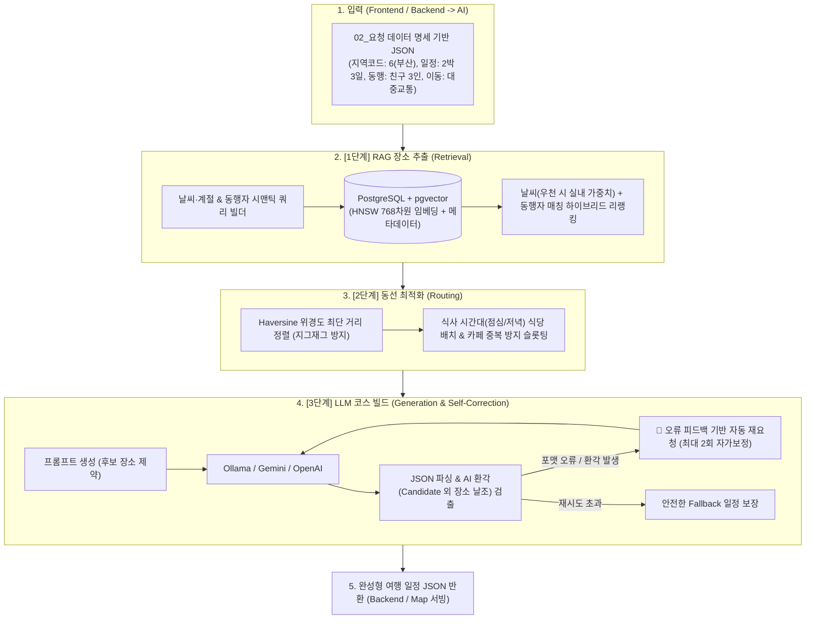

# 🧭 Trp AI Travel Recommendation Engine

> **날씨·계절 기반 RAG(Vector DB) 시맨틱 장소 추출 & 물리적 위경도 동선 최적화 & LLM 지능형 여행 일정 빌드 마이크로서비스**

---

## 📌 1. 아키텍처 개요

Trp AI 엔진은 단일 LLM 호출의 한계(지리 좌표 계산 오차, 지그재그 이동, 가짜 장소 환각 등)를 극복하기 위해 **[RAG 시맨틱 추출 ➡️ 지리적 동선 최적화 ➡️ LLM 맞춤형 일정 빌드]**의 3단계 파이프라인으로 동작합니다.



---

## 🚀 2. 주요 기능 및 특징

1. **`02_요청 데이터 명세 초안` 100% 지원**:
   - `regionCodes` (TourAPI 1:서울, 6:부산, 39:제주 등) 17개 시·도 코드 자동 매핑
   - `companionType` (SOLO, COUPLE, FRIENDS, FAMILY_WITH_KIDS 등) 동행자 맞춤 가중치 부여
   - `placesPerDay` (RELAXED: 3곳, NORMAL: 4곳, PACKED: 5곳) 일정 밀도 조절
   - `startTime` (EARLY: 08:00, NORMAL: 10:00, LATE: 11:00) 시간표 자동 분배
2. **지능형 하이브리드 RAG**:
   - 우천 예보 시 실내 장소(`is_indoor=true`)에 +20% 가중치 부여
   - 한국어 특화 `ko-sroberta` (768차원) HNSW 인덱스 기반 고속 코사인 유사도 검색
3. **지리적 거리 계산 및 카테고리 슬롯팅 (RoutePlanner)**:
   - Haversine 공식을 통한 물리적 이동 거리 및 소요 시간(분) 계산
   - 점심(12:00~) 및 저녁(18:00~) 식사 시간대 식당 배치, 카페 연속 방문 방지
4. **AI 환각 방지 및 자가보정(Self-Correction) 재시도 엔진**:
   - LLM이 반환한 장소가 후보군에 있는지 검증하고, 날조된 장소 발견 시 피드백 프롬프트와 함께 자동 재요청
   - 마크다운 블록 정제 및 Pydantic v2 스키마 구조화
5. **실시간 기상 악화 대응 재추천 (`reschedule`)**:
   - 여행 도중 갑작스러운 비가 올 때 현재 위치 반경 5km 내 실내 대체 명소로 동선 즉각 재조정

---

## 🛠️ 3. 설치 및 로컬 실행 방법

### 3.1 사전 요구사항
- Python 3.11 이상
- Docker 및 Docker Compose (PostgreSQL pgvector 및 Ollama 구동용)

### 3.2 로컬 인프라 구동 (Docker Compose)
```bash
# PostgreSQL (pgvector 16) 및 Ollama 컨테이너 실행
docker compose up -d

# Ollama 로컬 모델 다운로드 (Llama 3 8B 사용 시)
docker exec -it tour_ollama ollama pull llama3:8b
```

### 3.3 가상환경 생성 및 패키지 설치
```bash
python3 -m venv .venv
source .venv/bin/activate
pip install --upgrade pip
pip install -r requirements.txt
```

### 3.4 환경변수 설정
```bash
cp .env.example .env
# 필요에 따라 .env 내 DATABASE_URL, LLM_PROVIDER (ollama / gemini / openai) 설정
```

### 3.5 시드 데이터 적재
```bash
python3 scripts/seed_travel_data.py
```

### 3.6 FastAPI 서버 실행
```bash
uvicorn app.main:app --host 0.0.0.0 --port 8000 --reload
```
- Swagger UI 문서: `http://localhost:8000/docs`
- 헬스 체크: `http://localhost:8000/health`

---

## 📡 4. REST API 명세 요약

### 4.1 신규 맞춤형 여행 일정 생성
- **Endpoint**: `POST /api/v1/ai/schedule`
- **Request Body (02_요청 데이터 명세 규격)**:
```json
{
  "regionCodes": ["6"],
  "startDate": "2026-11-01",
  "endDate": "2026-11-03",
  "companionType": "FRIENDS",
  "travelerCount": 3,
  "transport": "PUBLIC_TRANSIT",
  "themes": ["FOOD", "NATURE"],
  "placesPerDay": "NORMAL",
  "startTime": "NORMAL"
}
```
- **Response Body**:
```json
{
  "tripName": "부산 미식·자연 친구와 함께하는 3일 코스",
  "weatherSummary": "강수확률 10% 맑고 선선한 가을 날씨로 대중교통 이동에 최적화된 코스입니다.",
  "dailySchedules": [
    {
      "day": 1,
      "date": "2026-11-01",
      "weatherCondition": "SUNNY",
      "places": [
        {
          "step": 1,
          "placeId": "uuid-or-id",
          "placeName": "해운대 블루라인파크",
          "category": "액티비티/체험",
          "startTime": "10:00",
          "endTime": "11:30",
          "stayTimeMinutes": 90,
          "latitude": 35.1587,
          "longitude": 129.1724,
          "reason": "오전 시간대 푸른 동해 바다를 조망하며 해변열차를 탑승하기 좋습니다."
        }
      ]
    }
  ]
}
```

### 4.2 실시간 대체 일정 재추천 (Reschedule)
- **Endpoint**: `POST /api/v1/ai/reschedule`
- **Request Body**:
```json
{
  "regionCode": "6",
  "currentLatitude": 35.1585,
  "currentLongitude": 129.1820,
  "newWeatherCondition": "RAIN",
  "radiusKm": 5.0,
  "remainingStepsCount": 3
}
```

---

## 🧪 5. 테스트 스위트 실행

```bash
# 전체 단위 및 통합 테스트 실행 (pytest)
python3 -m pytest tests -v
```
- `test_parser.py`: JSON 파싱, 문법 에러 감지, AI 환각(후보 외 장소) 검출
- `test_code_mapper_and_route.py`: 지역/동행 코드 변환, Haversine 거리 계산, 식사 슬롯팅 동선 정렬
- `test_retry_and_reschedule.py`: 오류 피드백 기반 자동 재요청(Self-Correction) 및 API 엔드포인트 검증

