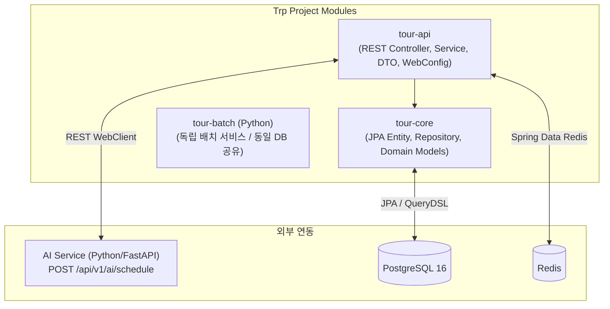
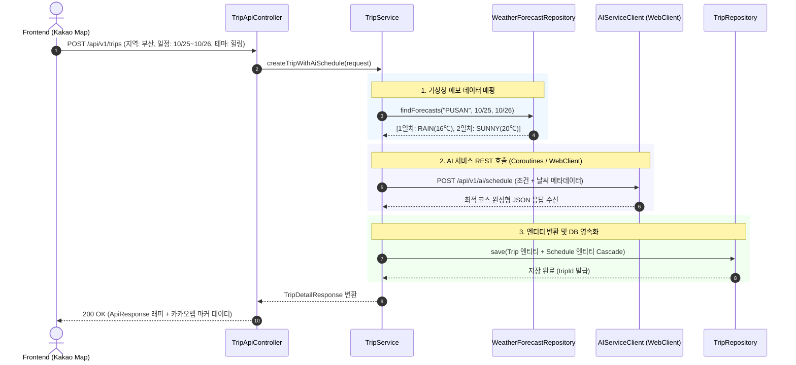
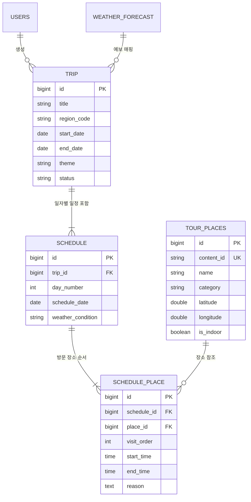

# 🛠 Trp Backend Service Specification (BACKEND.md)
> **Kotlin & Spring Boot 기반 3-Tier Layered 아키텍처, 여행 REST API 및 AI 오케스트레이션 서버**

```markdown
# 🔗 백엔드 서비스 Git 저장소 (Repository URL)
GIT_BACKEND_REPO="https://github.com/<ORGANIZATION_OR_USER>/trp-backend"
```

---

## 📌 목차
1. [백엔드 서비스 개요](#1-백엔드-서비스-개요)
2. [멀티모듈 및 시스템 아키텍처](#2-멀티모듈-및-시스템-아키텍처)
3. [REST API 전체 명세 (Service API)](#3-rest-api-전체-명세-service-api)
4. [AI 서비스 오케스트레이션 흐름 (Thin Backend)](#4-ai-서비스-오케스트레이션-흐름-thin-backend)
5. [공통 응답 규격 및 전역 예외 처리](#5-공통-응답-규격-및-전역-예외-처리)
6. [데이터베이스 스키마 및 JPA 엔티티](#6-데이터베이스-스키마-및-jpa-엔티티)
7. [Kotlin 코드 스타일 가이드](#7-kotlin-코드-스타일-가이드)
8. [표준 로깅(Logging) 가이드](#8-표준-로깅logging-가이드)
9. [프로젝트 관리 및 Git 협업 규약](#9-프로젝트-관리-및-git-협업-규약)
10. [환경 설정 규격 (application.yml & .env)](#10-환경-설정-규격-applicationyml--env)

---

## 1. 백엔드 서비스 개요

Trp 백엔드 서버는 **Kotlin과 Spring Boot**를 기반으로 개발된 멀티모듈 애플리케이션으로, 프론트엔드(React/Kakao Maps)의 여행 요청을 처리하고, 회원/일정/장소 데이터를 관리하며, **기상청 날씨 데이터 매핑 후 AI 마이크로서비스에 일정을 위임·오케스트레이션**하여 최종 응답을 제공합니다.

- **기반 기술**: Kotlin (1.9+), Spring Boot (3.x), Java (17+ LTS), Spring Data JPA, QueryDSL, Kotlin Coroutines
- **설계 철학 (Thin Backend & Clean Architecture)**:
  - 3-Tier Layered Architecture (`Controller` ➡️ `Service` ➡️ `Repository`)
  - AI 내부 로직(임베딩, 프롬프트, 벡터 검색)은 AI 서비스에 위임하고, 백엔드는 비즈니스 오케스트레이션 및 데이터 영속화에 집중
  - 코루틴(`Dispatchers.IO`) 및 비동기 WebClient를 활용한 외부 통신 성능 최적화

---

## 2. 멀티모듈 및 시스템 아키텍처

의존성 꼬임 방지와 코드 재사용성을 위해 Gradle 멀티모듈 구조를 채택합니다.



- **`tour-core`**: JPA 엔티티, Repository 인터페이스, 공통 비즈니스 도메인 모델만 순수하게 격리
- **`tour-api`**: 웹 계층(`@RestController`), DTO 매핑, 보안, 전역 예외 처리, 비즈니스 서비스 로직 전담

---

## 3. REST API 전체 명세 (Service API)

모든 API는 `/api/v1` 프리픽스를 사용하며, 일관된 JSON 래퍼 구조로 응답합니다.

### 3.1 여행(Trip) 관리 API
| API ID | Method | Endpoint | 설명 | 주요 Request Body | 주요 Response Data |
| :--- | :--- | :--- | :--- | :--- | :--- |
| **TR-001** | `POST` | `/api/v1/trips` | 신규 여행 생성 및 AI 일정 자동 발급 | `TripCreateRequest` (지역, 날짜, 테마) | `TripDetailResponse` (생성된 여행 및 일정) |
| **TR-002** | `GET` | `/api/v1/trips/{id}` | 여행 및 일정 단건 상세 조회 | - | `TripDetailResponse` |
| **TR-003** | `PUT` | `/api/v1/trips/{id}` | 여행 기본 정보(이름, 메모) 수정 | `TripUpdateRequest` | `TripResponse` |
| **TR-004** | `DELETE` | `/api/v1/trips/{id}` | 여행 및 하위 일정 삭제 (Soft Delete) | - | `CommonResultResponse` |

### 3.2 일정(Schedule) 및 내보내기 API
| API ID | Method | Endpoint | 설명 | 주요 Request Body | 주요 Response Data |
| :--- | :--- | :--- | :--- | :--- | :--- |
| **PLAN-001** | `POST` | `/api/v1/schedules` | 수동 편집된 일정 저장/수정 | `ScheduleSaveRequest` | `ScheduleResponse` |
| **PLAN-002** | `POST` | `/api/v1/schedules/share` | 읽기 전용 일정 공유 URL 생성 | `{"scheduleId": 101}` | `{"shareUrl": "https://trp.com/s/xyz"}` |
| **PLAN-003** | `GET` | `/api/v1/schedules/{id}/export/excel` | 여행 일정 엑셀 파일 다운로드 | - | Excel 바이너리 스트림 (`.xlsx`) |
| **PLAN-004** | `GET` | `/api/v1/schedules/{id}/export/pdf` | 여행 일정 PDF 파일 다운로드 | - | PDF 바이너리 스트림 (`.pdf`) |

### 3.3 지도(Map) 및 장소 탐색 API
| API ID | Method | Endpoint | 설명 | Query Parameters | 주요 Response Data |
| :--- | :--- | :--- | :--- | :--- | :--- |
| **MAP-001** | `GET` | `/api/v1/map/places` | 카카오맵 마커용 장소 목록 조회 | `regionCode`, `category`, `page` | `List<PlaceMarkerResponse>` |
| **MAP-002** | `GET` | `/api/v1/map/route` | 특정 여행 일차별 Polyline 동선 조회 | `tripId`, `dayNumber` | `RoutePolylineResponse` (좌표 배열) |
| **MAP-003** | `GET` | `/api/v1/map/navigation` | 출발-도착 최적 길찾기 경로 | `startLat`, `startLng`, `endLat`, `endLng` | `NavigationResponse` (시간, 거리) |
| **MAP-004** | `GET` | `/api/v1/map/nearby` | 내 주변(반경 N km) 관광지/맛집 탐색 | `lat`, `lng`, `radiusMeter=3000` | `List<PlaceSummaryResponse>` |
| **MAP-005** | `GET` | `/api/v1/map/search` | 키워드 장소 검색 | `keyword`, `page` | `List<PlaceSummaryResponse>` |

---

## 4. AI 서비스 오케스트레이션 흐름 (Thin Backend)

사용자가 **`POST /api/v1/trips`**로 여행 일정을 요청할 때 백엔드가 수행하는 내부 트랜잭션 흐름입니다.



---

## 5. 공통 응답 규격 및 전역 예외 처리

클라이언트와의 일관된 통신 계약을 위해 성공/실패 응답을 단일 규격으로 래핑합니다.

### 5.1 공통 응답 Wrapper (`ApiResponse<T>`)
```kotlin
data class ApiResponse<T>(
    val success: Boolean,
    val code: String,
    val message: String,
    val data: T? = null,
    val timestamp: String = LocalDateTime.now().format(DateTimeFormatter.ISO_DATE_TIME)
) {
    companion object {
        fun <T> success(data: T, message: String = "요청이 성공적으로 처리되었습니다."): ApiResponse<T> =
            ApiResponse(success = true, code = "SUCCESS", message = message, data = data)

        fun error(code: String, message: String): ApiResponse<Unit> =
            ApiResponse(success = false, code = code, message = message, data = null)
    }
}
```

### 5.2 전역 예외 처리기 (`GlobalExceptionHandler`)
`@RestControllerAdvice`를 통해 시스템 예외 및 커스텀 비즈니스 예외를 표준 JSON으로 변환합니다.

```kotlin
@RestControllerAdvice
class GlobalExceptionHandler {
    private val logger = LoggerFactory.getLogger(GlobalExceptionHandler::class.java)

    @ExceptionHandler(BusinessException::class)
    fun handleBusinessException(e: BusinessException): ResponseEntity<ApiResponse<Unit>> {
        logger.warn("비즈니스 예외 발생: code={}, message={}", e.errorCode.name, e.message)
        return ResponseEntity
            .status(e.errorCode.status)
            .body(ApiResponse.error(e.errorCode.name, e.message))
    }

    @ExceptionHandler(Exception::class)
    fun handleInternalError(e: Exception): ResponseEntity<ApiResponse<Unit>> {
        logger.error("처리되지 않은 서버 내부 오류: ", e)
        return ResponseEntity
            .status(HttpStatus.INTERNAL_SERVER_ERROR)
            .body(ApiResponse.error("INTERNAL_SERVER_ERROR", "서버 내부 오류가 발생했습니다."))
    }
}
```

---

## 6. 데이터베이스 스키마 및 JPA 엔티티

### 6.1 ERD 다이어그램


---

## 7. Kotlin 코드 스타일 가이드

Kotlin의 모던하고 간결한 언어적 특징을 극대화하기 위해 아래 컨벤션을 준수합니다.

### 7.1 코딩 컨벤션 표준
- **포매터 도구**: Kotlin 공식 컨벤션 및 **Ktlint** 사용
- **최대 줄 길이(Line Length)**: `120자`
- **들여쓰기**: 공백 4칸(Soft Tabs)

### 7.2 불변성 및 함수형 프로그래밍 원칙
- 프로퍼티와 변수는 무조건 `val` 선언을 원칙으로 하며, `var`는 상태 축적이 불가피한 경우 외에 금지합니다.
- 복사 및 수정이 필요한 DTO/값 객체는 `data class`의 `.copy()`를 활용합니다.
- `if-else` 또는 `when`을 표현식(Expression)으로 적극 활용하여 반환값을 직접 할당합니다.

```kotlin
// 모범 사례: when 표현식 활용
fun mapWeatherToPrompt(condition: WeatherCondition): String = when (condition) {
    WeatherCondition.RAIN -> "비 오는 날 어울리는 실내 명소 및 오션뷰 카페"
    WeatherCondition.SNOW -> "눈 오는 날 적합한 따뜻한 실내 명소"
    WeatherCondition.SUNNY -> "맑은 날 즐기기 좋은 야외 관광지"
    WeatherCondition.CLOUDY -> "흐린 날 산책하기 좋은 복합 문화공간"
}
```

### 7.3 Null Safety 규칙
- `!!` (단언 연산자) 사용을 엄격히 금지합니다.
- 안전 호출(`?.`), 엘비스 연산자(`?:`), `requireNotNull()`, 또는 스마트 캐스트를 사용합니다.

---

## 8. 표준 로깅(Logging) 가이드

- **로거 라이브러리**: `SLF4J + Logback` (Lombok `@Slf4j` 대신 코틀린 컴패니언 객체 또는 확장 함수 사용)
- **표준 로그 포맷**:
  ```text
  [2026-10-22 14:35:10.123] [INFO ] [req_id=a1b2c3] [TripService:45] - 여행 일정 생성 완료 | tripId=1024, placesCount=6, durationMs=350
  ```
- **MDC(Mapped Diagnostic Context)**: 모든 HTTP 요청에 유니크한 `traceId`를 발급하여 필터(Filter)에서 주입하고, 로그 출력 시 `[traceId]`를 함께 출력하여 분산 환경 추적성을 보장합니다.
- **민감정보 보호**: 사용자 비밀번호, 외부 API 시크릿 키는 로그 출력에서 마스킹 처리합니다.

---

## 9. 프로젝트 관리 및 Git 협업 규약

### 9.1 디렉터리 구조 (`tour-api`)
```text
tour-api/
├── src/main/kotlin/com/trip/api/
│   ├── controller/          # REST API 컨트롤러
│   ├── service/             # 비즈니스 오케스트레이션 로직
│   ├── client/              # AI Service 비동기 WebClient 연동
│   ├── dto/                 # Request/Response 데이터 객체
│   ├── common/              # ApiResponse, GlobalExceptionHandler
│   └── config/              # Security, WebClient, Redis 설정
└── src/test/kotlin/         # MockK, Kotest / JUnit5 테스트
```

### 9.2 Git 브랜치 전략 및 네이밍 규칙
`develop` 브랜치를 기준으로 분기하며 `접두사/티켓번호-작업내용` 규칙을 준수합니다.

| 접두사 (Type) | 사용 목적 | 브랜치 네이밍 예시 |
| :--- | :--- | :--- |
| `feat` | 신규 API 및 비즈니스 서비스 구현 | `feat/TOUR-20-trip-api-service` |
| `fix` | API 에러, DTO 매핑 버그 수정 | `fix/TOUR-24-schedule-null-pointer` |
| `refactor` | Coroutines 비동기 최적화, 쿼리 튜닝 | `refactor/TOUR-28-webclient-coroutine` |
| `docs` | BACKEND.md 및 API 스웨거 갱신 | `docs/TOUR-33-update-backend-spec` |

### 9.3 PR 작성 및 AI 코드 리뷰 집중 포인트
- **PR 작성 템플릿**:
  - `이슈 번호`, `작업 내용`, `AI 리뷰어 집중 확인 요청 (Review Point)`, `체크리스트`
- **AI 리뷰어 체크 포인트 (Review Point)**:
  - [ ] 트랜잭션(`@Transactional`) 범위가 외부 AI REST API 호출까지 불필요하게 물려있지 않은가? (DB 커넥션 고갈 방지)
  - [ ] 연관 엔티티 조회 시 N+1 쿼리 발생 가능성이 없는가?

---

## 10. 환경 설정 규격 (application.yml & .env)

환경별 접속 정보는 프로퍼티 및 환경변수로 분리 관리합니다.

```yaml
# application.yml
spring:
  application:
    name: tour-api
  datasource:
    url: ${DATABASE_URL:jdbc:postgresql://localhost:5432/tour_db}
    username: ${DB_USER:tour_admin}
    password: ${DB_PASSWORD:tour_password}
    driver-class-name: org.postgresql.Driver
  jpa:
    hibernate:
      ddl-auto: validate
    properties:
      hibernate:
        format_sql: true
        default_batch_fetch_size: 100
  data:
    redis:
      host: ${REDIS_HOST:localhost}
      port: ${REDIS_PORT:6379}
      password: ${REDIS_PASSWORD:tour_redis_pass}

# AI 마이크로서비스 연동 주소
ai:
  service:
    base-url: ${AI_SERVICE_BASE_URL:http://localhost:8000}
    timeout-seconds: 30
```

---

> 💡 **연관 문서**:
> - AI RAG 검색 및 동선 생성 엔진: [AI.md](./AI.md)
> - 데이터 수집 및 기상청 날씨 동기화: [BATCH.md](./BATCH.md)
> - 프론트엔드 카카오맵 및 일정 화면: [FRONTEND.md](./FRONTEND.md)
