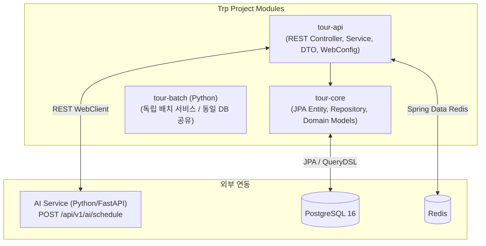
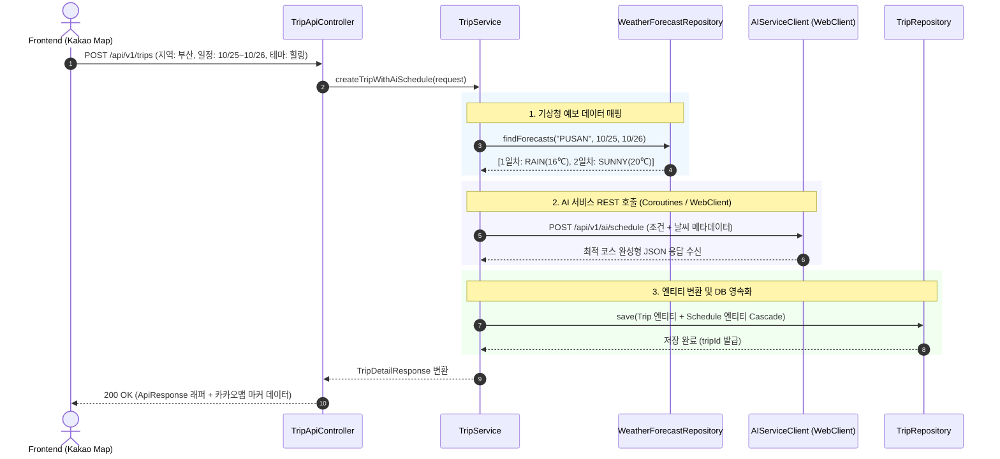
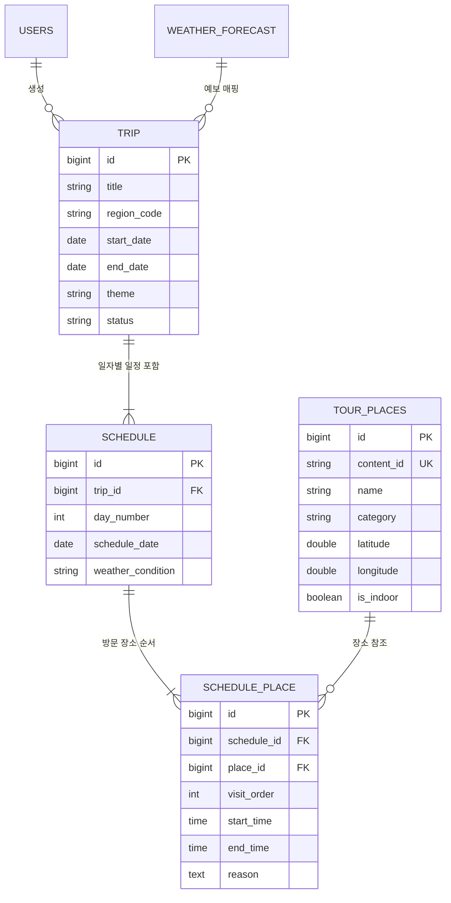

# 🛠 Trp Backend Service Specification (BACKEND.md)
> **Kotlin & Spring Boot 기반 3-Tier Layered 아키텍처, 여행 REST API 및 AI 오케스트레이션 서버**

```markdown
# 🔗 백엔드 서비스 Git 저장소 (Repository URL)
GIT_BACKEND_REPO="https://github.com/<ORGANIZATION_OR_USER>/trp-backend"
```

---

## 📌 목차
1. [백엔드 서비스 개요](#1-백엔드-서비스-개요)
2. [멀티모듈 및 시스템 아키텍처](#2-멀티모듈-및-시스템-아키텍처)
3. [REST API 전체 명세 (Service API)](#3-rest-api-전체-명세-service-api)
4. [AI 서비스 오케스트레이션 흐름 (Thin Backend)](#4-ai-서비스-오케스트레이션-흐름-thin-backend)
5. [공통 응답 규격 및 전역 예외 처리](#5-공통-응답-규격-및-전역-예외-처리)
6. [데이터베이스 스키마 및 JPA 엔티티](#6-데이터베이스-스키마-및-jpa-엔티티)
7. [Kotlin 코드 스타일 가이드](#7-kotlin-코드-스타일-가이드)
8. [표준 로깅(Logging) 가이드](#8-표준-로깅logging-가이드)
9. [프로젝트 관리 및 Git 협업 규약](#9-프로젝트-관리-및-git-협업-규약)
10. [환경 설정 규격 (application.yml & .env)](#10-환경-설정-규격-applicationyml--env)

---

## 1. 백엔드 서비스 개요

Trp 백엔드 서버는 **Kotlin과 Spring Boot**를 기반으로 개발된 멀티모듈 애플리케이션으로, 프론트엔드(React/Kakao Maps)의 여행 요청을 처리하고, 회원/일정/장소 데이터를 관리하며, **기상청 날씨 데이터 매핑 후 AI 마이크로서비스에 일정을 위임·오케스트레이션**하여 최종 응답을 제공합니다.

- **기반 기술**: Kotlin (1.9+), Spring Boot (3.x), Java (17+ LTS), Spring Data JPA, QueryDSL, Kotlin Coroutines
- **설계 철학 (Thin Backend & Clean Architecture)**:
  - 3-Tier Layered Architecture (`Controller` ➡️ `Service` ➡️ `Repository`)
  - AI 내부 로직(임베딩, 프롬프트, 벡터 검색)은 AI 서비스에 위임하고, 백엔드는 비즈니스 오케스트레이션 및 데이터 영속화에 집중
  - 코루틴(`Dispatchers.IO`) 및 비동기 WebClient를 활용한 외부 통신 성능 최적화

---

## 2. 멀티모듈 및 시스템 아키텍처

의존성 꼬임 방지와 코드 재사용성을 위해 Gradle 멀티모듈 구조를 채택합니다.



- **`tour-core`**: JPA 엔티티, Repository 인터페이스, 공통 비즈니스 도메인 모델만 순수하게 격리
- **`tour-api`**: 웹 계층(`@RestController`), DTO 매핑, 보안, 전역 예외 처리, 비즈니스 서비스 로직 전담

---

## 3. REST API 전체 명세 (Service API)

모든 API는 `/api/v1` 프리픽스를 사용하며, 일관된 JSON 래퍼 구조로 응답합니다.
일정 생성 요청의 필드와 코드값은 FE·AI의 일정 생성 요청 초안을 따릅니다 ([DATABASE.md 3장](../TP_DOCS/database/DATABASE.md#3-공통-코드-enum)).

### 3.1 한눈에 보기

| 기능 | Method | URL | FE에서 쓰는 곳 |
| :--- | :--- | :--- | :--- |
| **TR-001** 일정 생성 (AI) | `POST` | `/api/v1/trips` | 메인 질문 흐름의 [일정 만들기] |
| **TR-002** 여행·일정 조회 | `GET` | `/api/v1/trips/{tripId}` | 일정 화면 `/itinerary/:id` |
| **TR-003** 여행 이름·메모 수정 | `PUT` | `/api/v1/trips/{tripId}` | 일정 화면의 제목·메모 편집 |
| **TR-004** 여행 삭제 | `DELETE` | `/api/v1/trips/{tripId}` | 여행 삭제 |
| **PLAN-001** 하루 일정 편집 저장 | `POST` | `/api/v1/schedules` | 일정 편집 (순서 변경, 장소 추가·삭제, 시간 수정) |
| **PLAN-002** 공유 링크 만들기 | `POST` | `/api/v1/schedules/share` | [일정 공유 링크 복사] |
| **공유 조회** (추가) | `GET` | `/api/v1/shares/{token}` | 공유 링크를 연 사람의 화면 |
| **PLAN-003** 엑셀 다운로드 | `GET` | `/api/v1/schedules/{scheduleId}/export/excel` | [엑셀 다운로드] |
| **PLAN-004** PDF 다운로드 | `GET` | `/api/v1/schedules/{scheduleId}/export/pdf` | [PDF 다운로드] |
| **MAP-001** 지도 마커용 장소 | `GET` | `/api/v1/map/places` | 지도에 지역의 장소 마커 표시 |
| **MAP-002** 일차별 동선 | `GET` | `/api/v1/map/route` | 일차별 Polyline |
| **MAP-003** 길찾기 | `GET` | `/api/v1/map/navigation` | 두 장소 사이 이동 시간·거리 |
| **MAP-004** 주변 장소 | `GET` | `/api/v1/map/nearby` | 대체 장소 찾기, 내 주변 |
| **MAP-005** 장소 검색 | `GET` | `/api/v1/map/search` | 장소 이름 검색 (추가·대체) |

공유 조회는 표에 없던 API로, PLAN-002로 만든 링크를 열려면 필요해서 추가했습니다.

### 3.2 공통 규칙

- **응답 형식**: 성공·실패 모두 [5.1 `ApiResponse`](#51-공통-응답-wrapper-apiresponset)로 감쌉니다. 실제 데이터는 `data`에 있습니다. 실패하면 `success: false`와 함께 `code`(오류 코드)와 `message`(화면에 그대로 보여 줘도 되는 한국어 문구)가 오고 `data`는 `null`입니다. 파일 다운로드(PLAN-003·004)만 감싸지 않고 파일을 그대로 보냅니다.
- **날짜·시간**: 날짜는 `"2026-11-14"`, 시각은 `"10:30"`입니다 (요청에서는 `"10:30:00"`도 받음). 생성 시각은 한국 시간 ISO-8601 `"2026-11-11T13:59:51.176126+09:00"`입니다 (초 아래 자리는 길이가 달라질 수 있음).
- **이름**: JSON 필드는 camelCase, 코드값은 영문 대문자 그대로입니다 (예: `"PUBLIC_TRANSIT"`).
- **로그인**: 아직 없습니다. 모든 API를 로그인 없이 씁니다.
- **추적 ID**: 모든 응답 헤더에 `X-Trace-Id`가 있습니다. 오류를 알릴 때 이 값을 같이 주면 서버 로그에서 바로 찾을 수 있습니다.
- **페이지**: `page`는 0부터 셉니다. 목록 API는 전체 개수를 주지 않으므로, 받은 개수가 `size`보다 적으면 마지막 페이지입니다.

| 오류 코드 | HTTP | 언제 |
| :--- | :--- | :--- |
| `INVALID_REQUEST` | 400 | 필수값 누락, 형식·코드값 오류, 날짜·인원 규칙 위반 (`message`에 필드와 이유) |
| `REGION_NOT_FOUND` | 400 | 모르는 지역 코드 |
| `PLACE_NOT_FOUND` | 400 | 일정 편집에 없는(또는 폐업한) 장소가 들어 있음 |
| `TRIP_NOT_FOUND` | 404 | 없는 여행, 삭제된 여행 |
| `SCHEDULE_NOT_FOUND` | 404 | 없는 일정, 삭제된 여행의 일정 |
| `SHARE_NOT_FOUND` | 404 | 없는 공유 링크, 삭제된 여행의 링크 |
| `SHARE_EXPIRED` | 410 | 만료된 공유 링크 |
| `AI_SERVICE_ERROR` | 502 | AI 서비스 오류, 연결 실패 |
| `AI_INVALID_RESPONSE` | 502 | AI가 장소 목록에 없는 장소만 돌려줌 |
| `AI_SERVICE_TIMEOUT` | 504 | AI가 100초 안에 답하지 않음 |
| `NOT_FOUND`, `METHOD_NOT_ALLOWED` | 404, 405 | 없는 URL, 잘못된 메서드 |
| `EXPORT_FAILED`, `INTERNAL_SERVER_ERROR` | 500 | 서버 오류 |

### 3.3 여행 API

#### TR-001 `POST /api/v1/trips` — 일정 생성

여행 조건에 여행 기간의 날씨를 붙여 AI에 일정 생성을 맡기고, 저장한 결과를 돌려줍니다. AI 응답을 기다리므로 **최대 100초**까지 걸릴 수 있습니다 (FE 타임아웃은 120초).

요청 `TripCreateRequest` (FE `toTripRequest()` 결과 그대로):

```json
{
  "regionCodes": ["6"],
  "startDate": "2026-11-14",
  "endDate": "2026-11-15",
  "companionType": "FRIENDS",
  "travelerCount": 3,
  "transport": "PUBLIC_TRANSIT",
  "themes": ["FOOD", "NATURE"],
  "placesPerDay": "NORMAL",
  "startTime": "NORMAL"
}
```

| 필드 | 필수 | 규칙 |
| :--- | :--- | :--- |
| `regionCodes` | O | 1~5개. TourAPI 지역코드(예: 부산 `"6"`) 또는 `region_code`(예: `"PUSAN"`). 서로 다른 지역을 여러 개 골라도 되고(부산+서울 `["6", "1"]`), 첫 지역이 대표 지역이다. 한 지역을 코드 여러 개로 보내면 한 지역으로 본다 (전남광주 `["38", "5"]`). 날씨는 대표 지역 예보를 붙이고, AI에는 받은 코드를 그대로 넘긴다 |
| `startDate`, `endDate` | O | 출발일은 오늘(한국 시간) 이후, 도착일은 출발일과 같거나 뒤, 최대 14일 |
| `companionType` | O | `SOLO`, `COUPLE`, `FRIENDS`, `FAMILY_WITH_KIDS`, `FAMILY_WITH_PARENTS`, `GROUP` |
| `travelerCount` | O | `SOLO`면 1, 그 외에는 2~100 |
| `transport` | O | `CAR`, `PUBLIC_TRANSIT`, `WALK` |
| `themes` | | 0~3개, 빈 배열이면 '골고루'. `NATURE`, `HISTORY_CULTURE`, `FOOD`, `CAFE`, `ACTIVITY`, `SHOPPING`, `FESTIVAL`, `HEALING` |
| `placesPerDay` | | `RELAXED`, `NORMAL`(기본), `PACKED` |
| `startTime` | | `EARLY`, `NORMAL`(기본), `LATE` |

응답 `data`: [`TripDetailResponse`](#36-응답-객체). 만들어진 여행 ID는 `data.tripId`입니다.

실패하면 400(요청 값) 또는 502·504(AI)입니다. 실패한 여행은 `FAILED` 상태로 남고, 다시 요청하면 새 여행이 만들어집니다.

#### TR-002 `GET /api/v1/trips/{tripId}` — 여행·일정 조회

일정 화면에 필요한 데이터 전부입니다 (일자별 일정, 장소 좌표·이미지·추천 이유 포함). 응답 `data`: [`TripDetailResponse`](#36-응답-객체). 삭제된 여행은 404입니다.

#### TR-003 `PUT /api/v1/trips/{tripId}` — 여행 이름·메모 수정

```json
{ "title": "우리 부산 여행", "memo": "KTX 9시 출발" }
```

- `title`은 필수(100자 이하), `memo`는 2000자 이하입니다.
- PUT이라 보낸 값으로 바꿉니다. `memo`를 빼거나 비우면 메모가 지워지므로, 제목만 바꿀 때도 기존 메모를 같이 보냅니다.

응답 `data`: `TripResponse` (일정 목록 없이 여행 정보만).

#### TR-004 `DELETE /api/v1/trips/{tripId}` — 여행 삭제

응답 `data`: `{ "id": 12, "result": true }`. 이후 이 여행과 공유 링크는 404입니다 (DB에서 지우지 않고 `deleted_at`만 기록).

### 3.4 일정·공유·내보내기 API

#### PLAN-001 `POST /api/v1/schedules` — 하루 일정 편집 저장

하루(일차)의 방문 장소를 **통째로 바꿉니다.** 목록 순서가 방문 순서(`step` 1, 2, 3…)가 됩니다. 순서 변경, 추가, 삭제, 시간 수정 모두 바뀐 전체 목록을 보내면 됩니다.

```json
{
  "scheduleId": 101,
  "places": [
    { "placeId": 2, "startTime": "12:00", "endTime": "13:00" },
    { "placeId": 4, "startTime": "13:10", "endTime": "14:00", "reason": "식후 커피" },
    { "placeId": 1 }
  ]
}
```

- `scheduleId`: `TripDetailResponse.dailySchedules[].scheduleId`
- `placeId`: 장소 ID. TR-002 응답이나 MAP-001·004·005 응답의 `placeId`
- `startTime`·`endTime`·`reason`은 생략할 수 있고, 하루 최대 20곳입니다. 빈 배열을 보내면 그날 일정을 비웁니다.

응답 `data`: `ScheduleResponse` (`tripId`와 그날 일정). 오류: 400 `PLACE_NOT_FOUND`(없는·폐업한 장소), 400 `INVALID_REQUEST`(끝 시각이 시작보다 앞), 404 `SCHEDULE_NOT_FOUND`.

#### PLAN-002 `POST /api/v1/schedules/share` — 공유 링크 만들기

요청은 `{ "scheduleId": 101 }`입니다. 여행의 아무 일차 ID나 보내면 **여행 전체**를 공유합니다 ([DATABASE.md 팀 합의 4번](../TP_DOCS/database/DATABASE.md#팀-합의가-필요한-것) 제안).

응답 `data`: `{ "shareUrl": "https://trp.com/s/Pxt1ytUX…", "token": "Pxt1ytUX…" }`. 같은 여행은 몇 번 불러도 같은 링크입니다. `shareUrl`의 앞부분은 서버 설정 `SHARE_BASE_URL`이고, 로컬 개발에서는 `http://localhost:5173/s`입니다.

#### 공유 조회 `GET /api/v1/shares/{token}`

공유 링크를 연 사람의 화면(`/s/{token}`)이 쓰는 데이터입니다. 응답 `data`: [`TripDetailResponse`](#36-응답-객체) (읽기 전용, `memo`는 항상 `null`). 오류: 404 `SHARE_NOT_FOUND`, 410 `SHARE_EXPIRED`.

#### PLAN-003·004 `GET /api/v1/schedules/{scheduleId}/export/excel`, `/export/pdf` — 파일 다운로드

여행 전체 일정을 엑셀(.xlsx) 또는 PDF로 받습니다. `ApiResponse`로 감싸지 않고 파일을 그대로 보내며, 파일 이름은 `Content-Disposition` 헤더에 있습니다 (예: `우리 부산 여행_2026-11-14.xlsx`).

- 가장 간단한 방법은 링크입니다: `<a href="/api/v1/schedules/101/export/excel">`. 브라우저가 파일 이름까지 알아서 저장합니다.
- axios로 받을 때는 `responseType: "blob"`을 씁니다.
- 오류(없는 일정 등)는 파일 대신 JSON(`ApiResponse`)으로 옵니다.

### 3.5 지도·장소 API

#### MAP-001 `GET /api/v1/map/places` — 지도 마커용 장소

| 파라미터 | 필수 | 설명 |
| :--- | :--- | :--- |
| `regionCode` | O | TourAPI 지역코드(`6`) 또는 `region_code`. 시도를 고르면 하위 시군구 장소까지. 전남광주는 `38`·`5` 어느 쪽이든 전체가 나온다 |
| `category` | | `TOUR_SPOT`, `CULTURE`, `FESTIVAL`, `LEISURE`, `ACCOMMODATION`, `SHOPPING`, `RESTAURANT`, `CAFE` |
| `page`, `size` | | 0부터, 기본 100개 (최대 500) |

응답 `data`:

```json
[{ "placeId": 3, "name": "해운대해수욕장", "category": "TOUR_SPOT", "latitude": 35.1587, "longitude": 129.1604, "isIndoor": false }]
```

#### MAP-002 `GET /api/v1/map/route?tripId=12&dayNumber=1` — 일차별 동선

응답 `data`:

```json
{ "tripId": 12, "dayNumber": 1, "coordinates": [{ "step": 1, "placeId": 1, "lat": 35.0784, "lng": 129.0807 }] }
```

방문 순서대로라 그대로 `kakao.maps.Polyline`의 `path`로 쓰면 됩니다. TR-002 응답에도 장소 좌표가 있으므로 일정 화면에서는 이 API 없이 그려도 됩니다.

#### MAP-003 `GET /api/v1/map/navigation?startLat=…&startLng=…&endLat=…&endLng=…` — 길찾기

응답 `data`:

```json
{ "distanceMeters": 15322, "durationSeconds": 1839, "source": "KAKAO", "path": [{ "lat": 35.1152, "lng": 129.0422 }] }
```

- `source: "KAKAO"`: 카카오모빌리티 자동차 경로입니다. `path`는 실제 도로 좌표입니다.
- `source: "ESTIMATE"`: 서버에 카카오 키가 없거나 호출이 실패한 경우의 추정값입니다 (직선거리 × 1.3, 시속 30km). `path`는 출발·도착 두 점입니다.
- 지금은 자동차 기준만 있습니다.

#### MAP-004 `GET /api/v1/map/nearby` — 주변 장소

| 파라미터 | 필수 | 설명 |
| :--- | :--- | :--- |
| `lat`, `lng` | O | 기준 좌표 |
| `radiusMeter` | | 반경(m), 기본 3000 (100~20000) |
| `category` | | MAP-001과 같음 |
| `size` | | 기본 30개 (최대 100) |

응답 `data`: `PlaceSummaryResponse` 목록. **가까운 순**이고 `distanceMeters`가 채워집니다.

#### MAP-005 `GET /api/v1/map/search?keyword=해운대` — 장소 이름 검색

`keyword`는 필수(1~50자)이고, `page`(0부터)·`size`(기본 20, 최대 100)를 쓸 수 있습니다. 응답 `data`: `PlaceSummaryResponse` 목록 (이름순, `distanceMeters`는 `null`).

### 3.6 응답 객체

**`TripDetailResponse`** (TR-001, TR-002, 공유 조회)

```json
{
  "tripId": 12,
  "title": "부산 미식·바다 1박 2일",
  "status": "COMPLETED",
  "regionCode": "PUSAN",
  "regionName": "부산광역시",
  "regions": [
    { "regionCode": "PUSAN", "regionName": "부산광역시" }
  ],
  "startDate": "2026-11-14",
  "endDate": "2026-11-15",
  "companionType": "FRIENDS",
  "travelerCount": 3,
  "transport": "PUBLIC_TRANSIT",
  "themes": ["FOOD", "NATURE"],
  "placesPerDay": "NORMAL",
  "startTime": "NORMAL",
  "weatherSummary": "1일차 비 예보로 실내 위주",
  "memo": null,
  "createdAt": "2026-11-11T13:59:51.176126+09:00",
  "dailySchedules": [
    {
      "scheduleId": 101,
      "dayNumber": 1,
      "date": "2026-11-14",
      "weatherCondition": "RAIN",
      "temperature": 16.0,
      "precipitationProbability": 80,
      "places": [
        {
          "step": 1,
          "placeId": 1,
          "placeName": "국립해양박물관",
          "category": "CULTURE",
          "isIndoor": true,
          "address": "부산 영도구 해양로301번길 45",
          "imageUrl": null,
          "latitude": 35.0784,
          "longitude": 129.0807,
          "startTime": "10:00",
          "endTime": "11:30",
          "stayTimeMinutes": 90,
          "reason": "비를 피해 둘러보기 좋은 실내 전시"
        }
      ]
    }
  ]
}
```

- `regions`: 고른 지역 전부, 고른 순서대로. `regionCode`·`regionName`은 그중 첫 지역(대표 지역)입니다.
- `status`: `GENERATING`(생성 중), `COMPLETED`, `FAILED`. 생성 중이거나 실패한 여행은 `dailySchedules`가 빈 배열입니다.
- `title`·`weatherSummary`: AI가 지은 값입니다. `title`은 TR-003으로 바꿀 수 있습니다.
- 여행의 `startTime`은 코드값(`EARLY`·`NORMAL`·`LATE`)이고, 장소의 `startTime`·`endTime`은 시각(`"10:00"`)입니다.
- `weatherCondition`: `SUNNY`, `CLOUDY`, `RAIN`, `SNOW` 또는 `null`. 예보가 있던 날은 `temperature`(℃)와 `precipitationProbability`(%)도 채워지고, 예보가 없던 날은 AI가 가정한 날씨만 있습니다.
- `stayTimeMinutes`: `endTime - startTime`(분). 시각이 없으면 `null`입니다.
- `isIndoor`: 실내 장소 여부 (비 오는 날 표시 등).

**`TripResponse`** (TR-003): `TripDetailResponse`에서 `dailySchedules`만 뺀 것입니다.

**`ScheduleResponse`** (PLAN-001): `tripId`에 `dailySchedules[]` 한 개와 같은 필드(`scheduleId`, `dayNumber`, `date`, 날씨, `places`)가 같은 단계로 붙습니다.

**`PlaceSummaryResponse`** (MAP-004·005): `placeId`, `name`, `category`, `address`, `latitude`, `longitude`, `isIndoor`, `imageUrl`, `distanceMeters`.

### 3.7 FE에서 붙일 때

- 실제 데이터는 항상 `response.data.data`에 있습니다. `apiClient`에서 `data`만 꺼내 주면 편합니다 ([FRONTEND.md](../TP_FE/FRONTEND.md) API 통신 장).
- 오류일 때는 `error.response.data.message`를 그대로 보여 주면 됩니다.
- 타임아웃은 TR-001만 120초로 길게 잡습니다.

---

## 4. AI 서비스 오케스트레이션 흐름 (Thin Backend)

사용자가 **`POST /api/v1/trips`**로 여행 일정을 요청할 때 백엔드가 수행하는 내부 트랜잭션 흐름입니다.



---

## 5. 공통 응답 규격 및 전역 예외 처리

클라이언트와의 일관된 통신 계약을 위해 성공/실패 응답을 단일 규격으로 래핑합니다.

### 5.1 공통 응답 Wrapper (`ApiResponse<T>`)
```kotlin
data class ApiResponse<T>(
    val success: Boolean,
    val code: String,
    val message: String,
    val data: T? = null,
    val timestamp: String = LocalDateTime.now().format(DateTimeFormatter.ISO_DATE_TIME)
) {
    companion object {
        fun <T> success(data: T, message: String = "요청이 성공적으로 처리되었습니다."): ApiResponse<T> =
            ApiResponse(success = true, code = "SUCCESS", message = message, data = data)

        fun error(code: String, message: String): ApiResponse<Unit> =
            ApiResponse(success = false, code = code, message = message, data = null)
    }
}
```

### 5.2 전역 예외 처리기 (`GlobalExceptionHandler`)
`@RestControllerAdvice`를 통해 시스템 예외 및 커스텀 비즈니스 예외를 표준 JSON으로 변환합니다.

```kotlin
@RestControllerAdvice
class GlobalExceptionHandler {
    private val logger = LoggerFactory.getLogger(GlobalExceptionHandler::class.java)

    @ExceptionHandler(BusinessException::class)
    fun handleBusinessException(e: BusinessException): ResponseEntity<ApiResponse<Unit>> {
        logger.warn("비즈니스 예외 발생: code={}, message={}", e.errorCode.name, e.message)
        return ResponseEntity
            .status(e.errorCode.status)
            .body(ApiResponse.error(e.errorCode.name, e.message))
    }

    @ExceptionHandler(Exception::class)
    fun handleInternalError(e: Exception): ResponseEntity<ApiResponse<Unit>> {
        logger.error("처리되지 않은 서버 내부 오류: ", e)
        return ResponseEntity
            .status(HttpStatus.INTERNAL_SERVER_ERROR)
            .body(ApiResponse.error("INTERNAL_SERVER_ERROR", "서버 내부 오류가 발생했습니다."))
    }
}
```

---

## 6. 데이터베이스 스키마 및 JPA 엔티티

### 6.1 ERD 다이어그램


---

## 7. Kotlin 코드 스타일 가이드

Kotlin의 모던하고 간결한 언어적 특징을 극대화하기 위해 아래 컨벤션을 준수합니다.

### 7.1 코딩 컨벤션 표준
- **포매터 도구**: Kotlin 공식 컨벤션 및 **Ktlint** 사용
- **최대 줄 길이(Line Length)**: `120자`
- **들여쓰기**: 공백 4칸(Soft Tabs)

### 7.2 불변성 및 함수형 프로그래밍 원칙
- 프로퍼티와 변수는 무조건 `val` 선언을 원칙으로 하며, `var`는 상태 축적이 불가피한 경우 외에 금지합니다.
- 복사 및 수정이 필요한 DTO/값 객체는 `data class`의 `.copy()`를 활용합니다.
- `if-else` 또는 `when`을 표현식(Expression)으로 적극 활용하여 반환값을 직접 할당합니다.

```kotlin
// 모범 사례: when 표현식 활용
fun mapWeatherToPrompt(condition: WeatherCondition): String = when (condition) {
    WeatherCondition.RAIN -> "비 오는 날 어울리는 실내 명소 및 오션뷰 카페"
    WeatherCondition.SNOW -> "눈 오는 날 적합한 따뜻한 실내 명소"
    WeatherCondition.SUNNY -> "맑은 날 즐기기 좋은 야외 관광지"
    WeatherCondition.CLOUDY -> "흐린 날 산책하기 좋은 복합 문화공간"
}
```

### 7.3 Null Safety 규칙
- `!!` (단언 연산자) 사용을 엄격히 금지합니다.
- 안전 호출(`?.`), 엘비스 연산자(`?:`), `requireNotNull()`, 또는 스마트 캐스트를 사용합니다.

---

## 8. 표준 로깅(Logging) 가이드

- **로거 라이브러리**: `SLF4J + Logback` (Lombok `@Slf4j` 대신 코틀린 컴패니언 객체 또는 확장 함수 사용)
- **표준 로그 포맷**:
  ```text
  [2026-10-22 14:35:10.123] [INFO ] [req_id=a1b2c3] [TripService:45] - 여행 일정 생성 완료 | tripId=1024, placesCount=6, durationMs=350
  ```
- **MDC(Mapped Diagnostic Context)**: 모든 HTTP 요청에 유니크한 `traceId`를 발급하여 필터(Filter)에서 주입하고, 로그 출력 시 `[traceId]`를 함께 출력하여 분산 환경 추적성을 보장합니다.
- **민감정보 보호**: 사용자 비밀번호, 외부 API 시크릿 키는 로그 출력에서 마스킹 처리합니다.

---

## 9. 프로젝트 관리 및 Git 협업 규약

### 9.1 디렉터리 구조 (`tour-api`)
```text
tour-api/
├── src/main/kotlin/com/trip/api/
│   ├── controller/          # REST API 컨트롤러
│   ├── service/             # 비즈니스 오케스트레이션 로직
│   ├── client/              # AI Service 비동기 WebClient 연동
│   ├── dto/                 # Request/Response 데이터 객체
│   ├── common/              # ApiResponse, GlobalExceptionHandler
│   └── config/              # Security, WebClient, Redis 설정
└── src/test/kotlin/         # MockK, Kotest / JUnit5 테스트
```

### 9.2 Git 브랜치 전략 및 네이밍 규칙
`develop` 브랜치를 기준으로 분기하며 `접두사/티켓번호-작업내용` 규칙을 준수합니다.

| 접두사 (Type) | 사용 목적 | 브랜치 네이밍 예시 |
| :--- | :--- | :--- |
| `feat` | 신규 API 및 비즈니스 서비스 구현 | `feat/TOUR-20-trip-api-service` |
| `fix` | API 에러, DTO 매핑 버그 수정 | `fix/TOUR-24-schedule-null-pointer` |
| `refactor` | Coroutines 비동기 최적화, 쿼리 튜닝 | `refactor/TOUR-28-webclient-coroutine` |
| `docs` | BACKEND.md 및 API 스웨거 갱신 | `docs/TOUR-33-update-backend-spec` |

### 9.3 PR 작성 및 AI 코드 리뷰 집중 포인트
- **PR 작성 템플릿**:
  - `이슈 번호`, `작업 내용`, `AI 리뷰어 집중 확인 요청 (Review Point)`, `체크리스트`
- **AI 리뷰어 체크 포인트 (Review Point)**:
  - [ ] 트랜잭션(`@Transactional`) 범위가 외부 AI REST API 호출까지 불필요하게 물려있지 않은가? (DB 커넥션 고갈 방지)
  - [ ] 연관 엔티티 조회 시 N+1 쿼리 발생 가능성이 없는가?

---

## 10. 환경 설정 규격 (application.yml & .env)

환경별 접속 정보는 프로퍼티 및 환경변수로 분리 관리합니다.

```yaml
# application.yml
spring:
  application:
    name: tour-api
  datasource:
    url: ${DATABASE_URL:jdbc:postgresql://localhost:5432/tour_db}
    username: ${DB_USER:tour_admin}
    password: ${DB_PASSWORD:tour_password}
    driver-class-name: org.postgresql.Driver
  jpa:
    hibernate:
      ddl-auto: validate
    properties:
      hibernate:
        format_sql: true
        default_batch_fetch_size: 100
  data:
    redis:
      host: ${REDIS_HOST:localhost}
      port: ${REDIS_PORT:6379}
      password: ${REDIS_PASSWORD:tour_redis_pass}

# AI 마이크로서비스 연동 주소
ai:
  service:
    base-url: ${AI_SERVICE_BASE_URL:http://localhost:8000}
    timeout-seconds: 30
```

---

> 💡 **연관 문서**:
> - AI RAG 검색 및 동선 생성 엔진: [AI.md](../TP_AI/AI.md)
> - 데이터 수집 및 기상청 날씨 동기화: [BATCH.md](../TP_BATCH/BATCH.md)
> - 프론트엔드 카카오맵 및 일정 화면: [FRONTEND.md](../TP_FE/FRONTEND.md)
