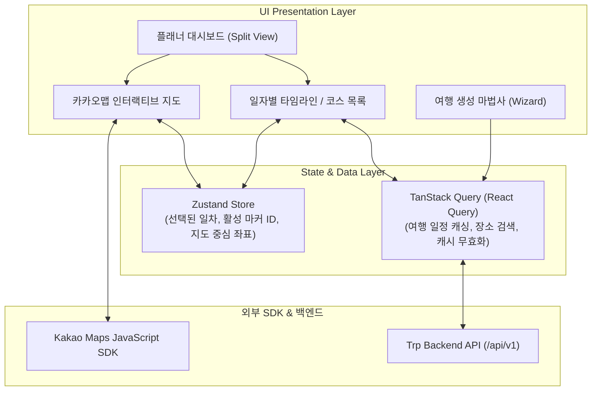

# 💻 Trp Frontend Client Specification (FRONTEND.md)
> **React & TypeScript 기반 카카오맵 인터랙티브 여행 플래너 및 반응형 웹 클라이언트**

```markdown
# 🔗 프론트엔드 서비스 Git 저장소 (Repository URL)
GIT_FRONTEND_REPO="https://github.com/<ORGANIZATION_OR_USER>/trp-frontend"
```

---

## 📌 목차
1. [프론트엔드 서비스 개요](#1-프론트엔드-서비스-개요)
2. [전체 클라이언트 아키텍처](#2-전체-클라이언트-아키텍처)
3. [핵심 사용자 화면(UI/UX) 구성](#3-핵심-사용자-화면uiux-구성)
4. [카카오맵(Kakao Maps SDK) 연동 상세 스펙](#4-카카오맵kakao-maps-sdk-연동-상세-스펙)
5. [상태 관리 및 데이터 캐싱 전략](#5-상태-관리-및-데이터-캐싱-전략)
6. [백엔드 API 통신 계층 (Client SDK)](#6-백엔드-api-통신-계층-client-sdk)
7. [TypeScript & React 코드 스타일 가이드](#7-typescript--react-코드-스타일-가이드)
8. [표준 로깅 및 에러 바운더리 (Error Boundary)](#8-표준-로깅-및-에러-바운더리-error-boundary)
9. [프로젝트 관리 및 Git 협업 규약](#9-프로젝트-관리-및-git-협업-규약)
10. [환경 설정 규격 (.env)](#10-환경-설정-규격-env)

---

## 1. 프론트엔드 서비스 개요

Trp 프론트엔드는 **React와 TypeScript**를 기반으로 개발된 SPA(Single Page Application)로, 여행자가 지역, 일정, 테마를 입력하면 AI가 생성한 **최적 일정과 동선을 카카오맵(Kakao Maps) 인터랙티브 지도 위에 시각화**해 주는 클라이언트 애플리케이션입니다.

- **기반 기술**: React (18+), TypeScript (5.x), Vite, Zustand (클라이언트 전역 상태), TanStack Query v5 (서버 상태 캐싱), Kakao Maps JavaScript SDK
- **핵심 가치**:
  - 날씨 예보에 따른 실시간 대체 코스 및 일정 시각화
  - 일자별 방문지 마커(Marker)와 이동 동선(Polyline)의 부드러운 지도 렌더링
  - 반응형 디자인 지원 (모바일/태블릿/데스크톱 대응)

---

## 2. 전체 클라이언트 아키텍처



---

## 3. 핵심 사용자 화면(UI/UX) 구성

### 3.1 여행 생성 화면 (Trip Create Wizard)
- **지역 선택**: 시/도 및 주요 관광 권역(부산, 제주, 강릉 등) 그리드 선택
- **일정 및 인원**: 캘린더 기반 여행 시작일/종료일 선택 (최대 7일)
- **여행 테마 및 이동수단**: 힐링, 카페/미식, 액티비티, 문화체험 / 대중교통 vs 자차
- **생성 로딩 UI**: AI가 날씨와 장소를 계산하는 동안 프로그레스 스켈레톤 및 안내 멘트 제공

### 3.2 메인 플래너 대시보드 (Split-View Layout)
- **좌측 패널 (35~40% 너비)**:
  - **상단 일자 탭**: [1일차 (10/25) 🌧️ 비 16℃] | [2일차 (10/26) ☀️ 맑음 20℃]
  - **시간대별 방문 카드**:
    - Step 번호 뱃지 (1, 2, 3...)
    - 장소명, 카테고리 태그(실내/실외 뱃지)
    - 체류 시간 (예: 10:30 ~ 12:30 / 120분)
    - **AI 날씨 팁 말풍선**: *"비 오는 날 바다를 조망하기 좋은 통창 카페입니다"*
    - 대체 장소 변경 버튼
  - **하단 액션바**: [일정 공유 링크 복사] | [엑셀 다운로드]
- **우측 패널 (60~65% 너비)**:
  - 전체 화면 카카오맵 지도 뷰
  - 일자별 방문지 순서 번호가 매겨진 커스텀 마커
  - 장소 간 이동 경로를 잇는 부드러운 Polyline 선

---

## 4. 카카오맵(Kakao Maps SDK) 연동 상세 스펙

### 4.1 SDK 로드 및 초기화
`index.html`에 스크립트를 직접 박지 않고, 비동기 로더 함수를 통해 안전하게 초기화합니다.

```typescript
// src/utils/kakaoMapLoader.ts
export const loadKakaoMap = (): Promise<typeof kakao> => {
  return new Promise((resolve, reject) => {
    if (window.kakao && window.kakao.maps) {
      resolve(window.kakao);
      return;
    }
    const script = document.createElement("script");
    script.src = `//dapi.kakao.com/v2/maps/sdk.js?appkey=${import.meta.env.VITE_KAKAO_MAP_API_KEY}&autoload=false`;
    script.async = true;
    script.onload = () => {
      window.kakao.maps.load(() => resolve(window.kakao));
    };
    script.onerror = (error) => reject(error);
    document.head.appendChild(script);
  });
};
```

### 4.2 마커(Marker) 및 Polyline 동선 렌더링
1. **커스텀 순서 마커 (`kakao.maps.CustomOverlay`)**:
   - 방문 순서 번호(1, 2, 3...)가 표기된 SVG 원형 뱃지 마커
   - 클릭 시 해당 장소로 지도 중심 부드럽게 이동(`panTo`) 및 타임라인 카드 스크롤 연동
2. **이동 동선 Polyline (`kakao.maps.Polyline`)**:
   ```typescript
   const polyline = new kakao.maps.Polyline({
     path: coordinates.map((coord) => new kakao.maps.LatLng(coord.lat, coord.lng)),
     strokeWeight: 5,
     strokeColor: "#3B82F6", // 활성 동선 파란색
     strokeOpacity: 0.8,
     strokeStyle: "solid",
   });
   polyline.setMap(mapInstance);
   ```
3. **지도 영역 자동 맞춤 (`setBounds`)**:
   - 일차별 장소들이 모두 화면에 들어오도록 `kakao.maps.LatLngBounds`를 계산하여 자동 확대/축소 조정

---

## 5. 상태 관리 및 데이터 캐싱 전략

역할에 따라 **클라이언트 UI 상태(Zustand)**와 **서버 비동기 데이터(TanStack Query)**를 명확히 분리합니다.

### 5.1 Zustand 클라이언트 전역 스토어 (`useTripUiStore`)
```typescript
import { create } from "zustand";

interface TripUiState {
  selectedDay: number;              // 현재 보고 있는 일차 (1, 2, 3...)
  hoveredPlaceId: number | null;    // 마우스 호버된 장소 ID
  selectedPlaceId: number | null;   // 상세 클릭된 장소 ID
  isPlaceModalOpen: boolean;        // 장소 상세/대체 모달 열림 여부
  setSelectedDay: (day: number) => void;
  setHoveredPlaceId: (id: number | null) => void;
  setSelectedPlaceId: (id: number | null) => void;
  setPlaceModalOpen: (isOpen: boolean) => void;
}

export const useTripUiStore = create<TripUiState>((set) => ({
  selectedDay: 1,
  hoveredPlaceId: null,
  selectedPlaceId: null,
  isPlaceModalOpen: false,
  setSelectedDay: (day) => set({ selectedDay: day }),
  setHoveredPlaceId: (id) => set({ hoveredPlaceId: id }),
  setSelectedPlaceId: (id) => set({ selectedPlaceId: id, isPlaceModalOpen: true }),
  setPlaceModalOpen: (isOpen) => set({ isPlaceModalOpen: isOpen }),
}));
```

### 5.2 TanStack Query 키 팩토리 및 훅
```typescript
// Query Key Factory
export const tripQueryKeys = {
  all: ["trips"] as const,
  detail: (tripId: number) => [...tripQueryKeys.all, "detail", tripId] as const,
  mapRoute: (tripId: number, day: number) => [...tripQueryKeys.all, "route", tripId, day] as const,
};

// 여행 상세 데이터 조회 훅
export const useTripDetailQuery = (tripId: number) => {
  return useQuery({
    queryKey: tripQueryKeys.detail(tripId),
    queryFn: () => tripApiClient.getTripDetail(tripId),
    staleTime: 1000 * 60 * 10, // 10분 캐싱 유지
  });
};
```

---

## 6. 백엔드 API 통신 계층 (Client SDK)

백엔드 공통 응답 규격인 `ApiResponse<T>`를 언래핑하여 비즈니스 데이터만 반환하는 전용 HTTP 클라이언트를 구성합니다.

```typescript
// src/api/httpClient.ts
import axios, { AxiosResponse } from "axios";

export interface ApiResponse<T> {
  success: boolean;
  code: string;
  message: string;
  data: T;
  timestamp: string;
}

export const httpClient = axios.create({
  baseURL: import.meta.env.VITE_API_BASE_URL || "/api/v1",
  timeout: 15000,
  headers: { "Content-Type": "application/json" },
});

// 공통 응답 인터셉터: data 프로퍼티 자동 언래핑
httpClient.interceptors.response.use(
  (response: AxiosResponse<ApiResponse<any>>) => {
    if (!response.data.success) {
      return Promise.reject(new Error(response.data.message || "API Error"));
    }
    return response.data.data;
  },
  (error) => {
    const message = error.response?.data?.message || "서버 통신 오류가 발생했습니다.";
    return Promise.reject(new Error(message));
  }
);
```

---

## 7. TypeScript & React 코드 스타일 가이드

프론트엔드 코드의 유지보수성과 일관성을 위해 아래 컨벤션을 엄격히 준수합니다.

### 7.1 포매팅 및 린팅 표준
- **도구**: ESLint + Prettier (Vite 표준 설정)
- **최대 줄 길이(Line Length)**: `100자`
- **따옴표**: 큰따옴표(`"`) 사용
- **세미콜론**: 필수 사용 (`;`)

### 7.2 컴포넌트 및 네이밍 규칙
- **컴포넌트 선언**: `export const ComponentName: React.FC<Props> = ...` 또는 함수 선언문, 파일명과 컴포넌트명은 `PascalCase` (예: `TimelineCard.tsx`)
- **커스텀 훅**: 파일명 및 함수명 모두 `use` 접두사 + `camelCase` (예: `useKakaoMap.ts`)
- **Props 및 인터페이스**: `interface ComponentNameProps { ... }` 형태로 작성하며 `type`보다 확장이 용이한 `interface`를 우선 사용
- **이벤트 핸들러 네이밍**:
  - Props로 전달 시: `on` 접두사 (`onClickPlace`, `onSelectDay`)
  - 내부 구현 함수: `handle` 접두사 (`handleClickPlace`, `handleSelectDay`)

### 7.3 불필요한 리렌더링 방지
- 지도 마커나 리스트 아이템 컴포넌트는 `React.memo`를 적절히 활용하여 상위 상태 변경 시 전체 마커가 재생성되지 않도록 방지합니다.
- 복잡한 좌표 배열 계산은 `useMemo`를 사용합니다.

---

## 8. 표준 로깅 및 에러 바운더리 (Error Boundary)

### 8.1 프론트엔드 표준 로깅 규칙
- `console.log()` 사용을 금지하며, 환경별 로거 헬퍼(`logger.ts`)를 사용합니다.
- 프로덕션 빌드 시 `DEBUG` 레벨 로그는 자동 제거됩니다.
```typescript
// src/utils/logger.ts
export const logger = {
  info: (msg: string, ...args: any[]) => console.info(`[INFO] ${msg}`, ...args),
  warn: (msg: string, ...args: any[]) => console.warn(`[WARN] ${msg}`, ...args),
  error: (msg: string, ...args: any[]) => console.error(`[ERROR] ${msg}`, ...args),
};
```

### 8.2 React Error Boundary 적용
카카오맵 로드 실패 또는 백엔드 예외 발생 시 화면 전체가 하얗게 깨지는 현상(Whiteout)을 방지하기 위해 Fallback UI를 제공합니다.

---

## 9. 프로젝트 관리 및 Git 협업 규약

### 9.1 패키지 디렉터리 구조
```text
tour-frontend/
├── src/
│   ├── api/                 # 백엔드 API 클라이언트 및 엔드포인트
│   ├── assets/              # 이미지, 마커 SVG, 전역 CSS
│   ├── components/          # 공통 UI 컴포넌트 (버튼, 모달, 스켈레톤)
│   │   ├── common/
│   │   ├── map/             # 카카오맵 지도 뷰 및 커스텀 오버레이
│   │   └── timeline/        # 일자별 코스 카드 및 액션바
│   ├── hooks/               # 커스텀 훅 (useKakaoMap, useTripDetail)
│   ├── pages/               # 라우팅 페이지 (HomePage, TripCreatePage, PlannerPage)
│   ├── stores/              # Zustand 전역 스토어
│   ├── types/               # DTO 및 도메인 인터페이스 타입 정의
│   ├── utils/               # 날짜 포매터, 로거, 카카오맵 로더
│   ├── App.tsx
│   └── main.tsx
├── public/
├── index.html
├── package.json
└── vite.config.ts
```

### 9.2 Git 브랜치 전략 및 네이밍 규칙
`develop` 브랜치에서 분기하며 `접두사/티켓번호-작업내용` 규칙을 따릅니다.

| 접두사 (Type) | 사용 목적 | 브랜치 네이밍 예시 |
| :--- | :--- | :--- |
| `feat` | 카카오맵 마커 렌더링, 신규 UI 컴포넌트 개발 | `feat/TOUR-12-map-marker-ui` |
| `fix` | 지도 줌 오류, 모바일 화면 깨짐, DTO 타입 에러 수정 | `fix/TOUR-16-map-bounds-error` |
| `refactor` | Zustand 스토어 리팩토링, TanStack Query 키 최적화 | `refactor/TOUR-27-query-cache-opt` |
| `docs` | FRONTEND.md 명세서 갱신 및 컴포넌트 문서화 | `docs/TOUR-34-update-frontend-spec` |

### 9.3 PR 템플릿 및 AI 리뷰어 집중 확인 포인트 (Review Point)
- **PR Self-Check**:
  - [ ] 카카오맵 언마운트 시 인스턴스 정리(메모리 누수 방지)가 처리되었는가?
  - [ ] TanStack Query의 `staleTime`과 캐시 무효화 타이밍이 적절한가?
  - [ ] 모바일/태블릿 반응형 뷰에서 깨짐이 없는가?
- **AI 리뷰어 체크 포인트 (Review Point)**:
  - "불필요한 리렌더링 유발 요소 검토", "비동기 API 에러 처리 누락 여부"

---

## 10. 환경 설정 규격 (.env)

```env
# Kakao Maps JavaScript API Key
VITE_KAKAO_MAP_API_KEY=your_kakao_javascript_key_here

# Backend API Endpoint
VITE_API_BASE_URL=http://localhost:8080/api/v1
```

---

> 💡 **연관 문서**:
> - 백엔드 서비스 REST API 명세서: [BACKEND.md](./BACKEND.md)
> - AI RAG 검색 및 동선 생성 엔진: [AI.md](./AI.md)
> - 데이터 수집 및 기상청 날씨 동기화: [BATCH.md](./BATCH.md)
